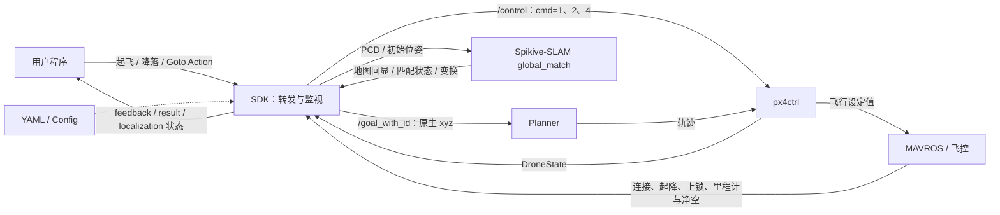

# Spikive-Control-SDK

**一个转发命令、监视状态、整理接口的 ROS1 Noetic C++ SDK。** 用户提交 Action，SDK 转发一次已有命令，再把控制器和 MAVROS 状态转成反馈与结果。实际飞行仍由现有 Planner、px4ctrl 和飞控执行。

现已增加 PCD 地图加载、初始位姿重定位和匹配结果适配，详见 [定位与点云加载 README](docs/README_定位与点云加载.md)（含最简命令、PDF 对照和流程图）。

包名 `spikive_control_sdk`，节点名 `spikive_control_sdk_node`。程序逻辑、字段对照和检查结论见 [开发逻辑](docs/开发逻辑.md)。

最简命令行调用和 `rostopic echo` 监控见 [命令行测试 README](docs/README_命令行测试.md)。

> Takeoff 当前完成了接口结构和现有控制链路的状态适配；请求高度、爬升速度、超时及稳定阶段尚未实现。具体见下方“Takeoff 与 PDF 逐项对照”，字段存在不代表对应能力已生效。

## 系统框图



| 模块 | 职责 |
| --- | --- |
| SDK | 统一 Action 接口；转发命令；监视状态并返回结果 |
| Planner / WayPoint | 规划轨迹 / 管理航点执行 |
| px4ctrl / 飞控 | 执行起飞、降落和轨迹控制 |
| MAVROS | 传递飞控指令与遥测状态 |
| Manager / 前端 | 管理系统进程 / 提供用户操作入口 |

## 命令与状态对应

| 功能 | 输入与转发 | 完成条件 |
| --- | --- | --- |
| 起飞 | `/nav/flight/takeoff` → `/control`，`cmd=1` | 新的 `DroneState.tookoff=true` |
| 降落 | `/nav/flight/land` → `/control`，`cmd=2` | 新的 `DroneState.landed=true` 且 MAVROS 为 `ON_GROUND`，连接有效 |
| 目标点飞行 | `/nav/flight/goto` → `/control` 的 `cmd=4`，随后 `/goal_with_id` 的 `GoalSet` | 新 `reached=true`，且新里程计满足三维、水平距离阈值和稳定时长 |
| 上锁报告 | 读取 `/mavros/state` | 新的 `connected=true && armed=false` → `Land.disarmed=true` |
| 取消 | 结束当前 Action 跟踪 | 返回 `success=false, error_code=3`；飞机继续原控制 |

这里的“新”指消息 `header.stamp` 严格晚于本次命令。成功返回 `error_code=0`。**降落在确认着地后成功，是否上锁单独报告，不等待或执行上锁。** `disarmed=false` 表示尚未确认上锁；结果返回后不再更新。

三个飞行 Action 共用一个任务槽，忙时拒绝新请求（`21`）。此互斥只覆盖本节点；前端、WayPoint 等其他 `/control` 或 `/goal_with_id` 发布者仍按原链路工作。发布命令不等于后端已接受，完成依据始终来自状态。

| Action 参数 | 本版处理 | 实际执行来源 |
| --- | --- | --- |
| `target_altitude` | 预留，任何值均忽略 | px4ctrl 启动时读取的 `hover_height`，launch 的 `init_z` 传入 |
| `climb_speed` | 预留，任何值均忽略 | 原公式 `vz = (hover_height - position_z) × 1` |
| `descend_speed` | 预留，任何值均忽略 | px4ctrl 的 `landing_speed` |
| Goto `speed` | 预留，有限值均忽略 | Planner 原有速度配置；GoalSet 无速度字段 |
| 三个 `timeout` | 预留，不执行；Goto 仍检查有限值 | 没有任务超时或状态超时策略；无完成证据时等待或由客户端取消 |

Action 的字段、类型、顺序保留 [V1.1 PDF](docs/specs/ROS接口规范V1.1.pdf) 定义（Goto 坐标语义按项目约定调整，见下表）。SDK 不生成 setpoint、不调用解锁/上锁/模式服务、不修改飞控参数。状态监视输出为现有 Action 的 feedback/result 和 C++ 状态访问接口，新增的 `/nav/status/localization` 见定位说明；其余 `/nav/status/*` 话题未扩展。

## Goto：V1.1 对应关系

新增 [goto.action](action/goto.action)，入口 `/nav/flight/goto`，生成类型 `spikive_control_sdk/gotoAction`。Goal 6 个字段、Result 4 个字段、Feedback 4 个字段与 PDF §3.1.2 的类型、名称、顺序一致。

**坐标按项目原生定义：`position=[x,y,z]` 直接转发为 `GoalSet.goal`。** 这是用户明确指定的 PDF 语义调整：不采用 PDF 注释中的 NED，不交换 x/y、不反转 z。它是局部坐标中的绝对目标，不是相对当前位置的位移。目标、Planner 和 MAVROS 里程计必须使用相同原点和坐标轴；SDK 不做 TF、原点对齐或航向标定。

| PDF 字段 / 能力 | 状态 | 当前处理 |
| --- | --- | --- |
| `position` | 已完成；坐标语义按项目调整 | 原生 `[x,y,z]`，m，透传至 `/goal_with_id` |
| `speed` | 预留 | 有限值均忽略并记录日志；不改变 Planner 速度 |
| `arrival_total_dist` | 已完成 | 三维距离阈值；正值用请求，`<=0` 用 Config 的 0.30 m |
| `arrival_horiz_dist` | 已完成 | 水平距离阈值；正值用请求，`<=0` 用 Config 的 0.25 m |
| `stable_time` | 已完成样本判定 | 两个距离和控制器到达状态持续满足的观测时长；正值用请求，`<=0` 用 Config 的 1.0 s |
| `timeout` | 预留 | 有限值均忽略；未实现任务超时 |
| `success / error_code / message` | 已完成当前分支 | 成功 `0`；取消 `3`；拒绝 `4/6/12/19/20/21`；目标发出前条件变化中止 `12` |
| `final_distance` | 已完成 | 结束时最新有效里程计到本请求目标的三维距离；无效位置或请求被拒绝时 NaN |
| `state` | 部分完成 | `1 NAVIGATING` → `3 HOLDING` → `4 DONE`；条件失去时回到 1；缺少避障状态来源，不输出 `2 AVOIDING` |
| `distance_total / distance_horizontal` | 已完成 | 原生坐标差的三维 / XY 范数，m；无效位置为 NaN |
| `current_speed` | 已完成 | MAVROS 里程计线速度的三维模长，m/s；无效速度为 NaN |

Goto 要求 MAVROS `IN_AIR`、有效且带时间戳的 xyz，以及控制/目标话题均有订阅者；不要求 `tookoff=true`，因为控制器在轨迹飞行时会清除此标志。所有请求数值必须有限，否则返回 `19`。

转发顺序沿用 WayPoint：先发 `cmd=4`（Continue），用单次定时器等待 0.2 s，再发真实目标。FlightManager 在切换到 Continue 时会先发布当前位置，因此不能同时发送真实目标；0.2 s 是已有顺序约定，不是接收确认，负载下仍不能保证跨节点处理次序。等待期间取消会撤销尚未发送的目标，但不撤回已发送的 Continue。

完成同时要求连接有效、MAVROS `IN_AIR`、命令之后的 `DroneState.reached && !landed`、命令之后的里程计、两个距离阈值和稳定时长。以两个消息时间戳的较小值累计时长；反馈定时器不会用静止缓存推进成功。任一到达条件不满足或观测时间倒退时重计。没有状态年龄/断流策略，样本间隔内是否连续满足无法证明；时间戳先后也不是目标 ACK。

现有后端边界保留：`reached` 只有 XY 判据，所以 SDK 补算三维距离和稳定时长；SDK 阈值不改写控制器 `reach_dist`。Planner 会忽略 `z<-0.1` 的目标，本版提前拒绝并返回 `20`；地形跟随可能改写目标 z，而 SDK 始终按请求坐标监视距离；重复 XY、仅变 z 的目标不保证触发新的控制器到达过程。这些情况可能持续等待，需客户端取消。SDK 不修改 Planner 或控制器，也不能从现有消息识别其他发布者替换了目标。

## Takeoff 与 PDF 逐项对照

核对日期：2026-10-16。依据 V1.1 PDF 第 4 页 §3.1.1（Takeoff/Land 字段与 V0.1 相同），以及 §1.2 Action 原则、§1.3 通用错误码和 §2 接口总览。源码依据为 [takeoff.action](action/takeoff.action)、[Action 节点](src/flight_control_node.cpp) 和 [命令封装](src/control_sdk.cpp)。以下“完成”指源码已实现，不表示已通过飞行验证；本节只记录现状，不改变之前约定的预留范围。

### 接口及全部字段

`/nav/flight/takeoff` 已提供 ActionServer，具备请求接收、反馈和结果返回。Goal / Result / Feedback 各 3 个字段，类型、名称、顺序与分隔位置均一致。**接口结构已完成，起飞能力尚未完整实现 PDF 字段所表达的功能。**

| 部分 | PDF 字段与含义 | 定义 | 功能状态与当前实现 |
| --- | --- | --- | --- |
| Goal | `float32 target_altitude`：目标高度，m，相对起飞点地面 | 已完成 | **未完成**：任何值均忽略，不把请求高度换算或传给控制器。实际仍执行 px4ctrl 的 `hover_height`，不保证到达请求高度。 |
| Goal | `float32 climb_speed`：爬升速度，m/s，`<=0` 使用默认 | 已完成 | **未完成**：正值和 `<=0` 均忽略，没有按请求选速或选择默认速度的分支；仍用后端原比例公式。 |
| Goal | `float32 timeout`：超时，s | 已完成 | **未完成**：没有任务超时计时、超时终止或 `ERR_TIMEOUT=2` 返回。 |
| Result | `bool success` | 已完成 | **已完成现有状态映射**：命令之后的 `DroneState.tookoff=true` 返回 true；拒绝、取消返回 false。这里的成功不是到达 Goal.target_altitude 的确认。 |
| Result | `uint8 error_code` | 已完成 | **已完成当前分支编码**：Takeoff 实际返回 `0/3/4/7/12/21`；未覆盖的错误见下表。 |
| Result | `string message` | 已完成 | **已完成**：成功、拒绝、取消均填写原因说明。 |
| Feedback | `uint8 phase`：1 PRECHECK、2 CLIMBING、3 STABILIZING、4 DONE | 已完成 | **部分完成**：输出 1、2、4；没有输出 3，具体见阶段表。 |
| Feedback | `float32 current_altitude` | 已完成 | **已完成反馈（本版基准）**：MAVROS 当前 z 减去本次命令前的 z；收到无效 z 时为 NaN。PDF 未单独说明该字段的高度基准，此处采用项目约定。 |
| Feedback | `float32 progress`：0.0～1.0 | 已完成 | **已完成值域要求，采用简化实现**：未完成为 0，完成为 1；连续百分比未实现。PDF 没有明确要求连续变化，不能据此认定违反值域约定。 |

命名差异：PDF 标题写 `Takeoff.action`，本项目沿用此前确定的 `takeoff.action`，生成类型为 `spikive_control_sdk/takeoffAction`。字段布局一致，客户端需使用本包实际生成的类型名称；本次未改名。

### 四个阶段

| PDF 阶段 | 状态 | 实际逻辑 / 尚缺内容 |
| --- | --- | --- |
| `1 PRECHECK` | **已完成阶段映射；自检范围有限** | 接受请求后先反馈 1；新状态未体现起飞进展时也映射为 1。请求接受前只检查通信、状态、地面条件和有限里程计 z；不代表已完成电池、定位质量等完整飞行自检。PDF 未列自检清单。 |
| `2 CLIMBING` | **已完成状态映射** | 新 DroneState 的 `landed=false`，或新 MAVROS 状态为 `TAKEOFF/IN_AIR` 时反馈 2；更新仍要求已有命令之后的 DroneState。不另外用垂直速度判断爬升。 |
| `3 STABILIZING` | **未完成** | 没有独立稳定信号、稳定检测或阶段 3 输出。PDF 未规定稳定阈值及持续时间，本版不自行增加判据。 |
| `4 DONE` | **已完成状态映射** | 新 `tookoff=true` 时反馈 4、`progress=1`，再返回成功并释放任务槽。无需先经历阶段 2；不等待阶段 3。 |

`tookoff` 来自 现有 `Spikive-Planner-SDK/src/planner/drone_control/src/px4ctrl.cpp`，其条件为 `takeoff_triggered && is_in_air && reached_hover_height`，其中 `reached_hover_height` 使用 `abs(hover_height-position_z)<0.1`。这属于现有控制器约定，**PDF 没有指定这个成功判据**。

### Takeoff 错误与结束方式

PDF §1.3 的错误码表注明“仅做参考”，没有要求 Takeoff 必须实现全部通用错误。下面区分已实现的返回分支与尚未接入的检测能力。

| 错误码 / 场景 | 状态 | 当前处理 |
| --- | --- | --- |
| `0 OK` | **已完成** | 新 `tookoff=true` 时返回成功。 |
| `3 ERR_CANCELLED` | **已完成跟踪取消** | 取消当前 Action，返回 false，释放任务槽；不发送停止、悬停或降落命令。取消对飞机的具体行为是本项目约定，PDF 未细化。 |
| `4 ERR_POSE_INVALID` | **部分检测** | 请求时未收到有效里程计 z，或 z 非有限值，则拒绝；不检查完整位姿、定位质量或数据年龄。任务中出现无效 z 只反馈 NaN，不自动终止。 |
| `7 ERR_ALREADY_FLYING` | **已完成** | `tookoff=true`、`landed=false` 或 MAVROS 已知状态不是 ON_GROUND 时拒绝。 |
| `12 ERR_PRECHECK_FAILED` | **已完成基础准入** | 缺 DroneState、MAVROS 未连接、ExtendedState 未知、控制话题无订阅者或 ROS 时间无效时拒绝；不代表完整飞行自检。 |
| `21 ERR_BUSY` | **已完成本节点互斥** | 起飞、降落或 Goto Action 跟踪中拒绝新请求；不约束外部 `/control` 发布者。 |
| `2 ERR_TIMEOUT` | **未完成** | timeout 不生效，不会因等待时间到达而返回此码。 |
| `19 ERR_PARAM_INVALID` | **未完成** | 三个预留 Goal 参数只记录日志，不做范围或有限值校验，也不返回此码。PDF 尚未给出具体合法范围。 |
| 其他通用错误码 | **本 Takeoff 未接入** | 如定位质量不足、低电量、紧急状态等，没有对应检测或结果分支；不将通用参考表全部列为 Takeoff 强制要求。 |

当前 Takeoff 任务接受后，仅实现“状态确认成功”与“客户端取消”两种终止路径，未实现运行中故障转为 Action ABORTED 的分支。没有后续完成证据时持续等待；命令之后的时间戳过滤用于排除旧缓存，不是控制器 ACK，也不是状态新鲜度检查。这些是当前实现边界，PDF 未给出完整的故障终止与通信时序规则。

### 本次核对结论

- **已完成**：Action 入口、9 个字段定义、一次 cmd=1 转发、基础准入与互斥、现有状态成功返回、原因说明、阶段 1/2/4、高度反馈、0/1 进度和跟踪取消。
- **未完成**：请求目标高度生效、请求爬升速度及默认选择、任务超时、阶段 3 STABILIZING。参数校验、运行中故障终止和连续进度也未实现，其具体规则未由当前 PDF 完整规定。
- **不能声称已完成**：完整飞行自检、按请求高度/速度执行的起飞、稳定悬停确认，以及实机验证。PDF 的字段一致性与功能完整性分别评估。

该 Takeoff 对照表记录字段和源码分支；新增 Goto 不改变 Takeoff 的功能范围。Noetic 编译通过只证明消息生成、编译和链接，不证明预留功能生效。

## 配置与启动

[config/control_sdk.yaml](config/control_sdk.yaml) 配置通信、反馈频率和 Goto 到达监视判据，启动时加载，修改后重启。

| 配置 | 默认值 |
| --- | --- |
| launch `drone_id` | `1`；范围 0–32767，用于默认状态话题和 `GoalSet.drone_id`；`/control` 本身没有 id 路由 |
| `topics/control` / `topics/drone_state` | `/control` / 空值自动生成 `/drone_{id}_state` |
| `topics/goal` | `/goal_with_id` |
| `topics/mavros_state` / `topics/extended_state` | `/mavros/state` / `/mavros/extended_state` |
| `topics/odometry` / `topics/altitude` | `/mavros/local_position/odom` / `/mavros/altitude` |
| `actions/takeoff` / `actions/land` | `/nav/flight/takeoff` / `/nav/flight/land` |
| `actions/goto` | `/nav/flight/goto` |
| `goto/arrival_total_dist` / `goto/arrival_horiz_dist` | `0.30` m / `0.25` m |
| `goto/stable_time` | `1.0` s |
| `feedback_rate` | `10.0` Hz；只控制反馈频率 |

定位配置位于同一 YAML 的 `localization/*`，按 id 生成后端话题，地图确认等待默认 5 s、状态发布默认 10 Hz。定位任务槽独立于现有飞行任务槽；初始位姿匹配应在起飞前完成。

先按原流程启动 MAVROS、Planner、px4ctrl 及状态转发节点。SDK launch 只启动本节点：

```bash
roslaunch spikive_control_sdk spikive_control_sdk.launch drone_id:=1
# 自定义配置可追加：config_file:=/absolute/path/control_sdk.yaml
```

下面是降落调用，会发送真实命令；起飞改用 `takeoffAction`、`takeoffGoal(target_altitude=0, climb_speed=0, timeout=0)` 和起飞接口。

```python
import actionlib, rospy
from spikive_control_sdk.msg import landAction, landGoal
rospy.init_node("land_client")
client = actionlib.SimpleActionClient("/nav/flight/land", landAction)
client.wait_for_server()
client.send_goal(landGoal(descend_speed=0, timeout=0))
client.wait_for_result()
print(client.get_result())
```

## 编译

在已安装 MAVROS、PCL/pcl_conversions、OpenSSL 开发库的 Noetic 环境中，仅加入消息依赖和本包。独立克隆本仓库时，仍需要已有 `controller_msgs`、`quadrotor_msgs` 包；不需要编译 SLAM 或 Planner 实现。下面以原工作区为源码位置：

```bash
source /opt/ros/noetic/setup.bash
sdk_source=/home/colman/Project/Spikive-Planner-SDK
sdk_build_ws=$(mktemp -d /tmp/spikive-control-sdk.XXXXXX)
mkdir -p "$sdk_build_ws/src"
ln -s "$sdk_source/src/Utils/controller_msgs" "$sdk_build_ws/src/controller_msgs"
ln -s "$sdk_source/src/Utils/quadrotor_msgs" "$sdk_build_ws/src/quadrotor_msgs"
ln -s "$sdk_source/src/Spikive-Control-SDK" "$sdk_build_ws/src/spikive_control_sdk"
cd "$sdk_build_ws"
catkin_make install -j2 -l2 -DCMAKE_BUILD_TYPE=Release
source install/setup.bash
```

Docker 中将 `sdk_source` 改为容器内源码路径。验收止于三个飞行 Action 生成、C++ 编译链接及安装，不启动飞行节点。开发 Skill：`$spikive-control-sdk`（`~/.codex/skills/spikive-control-sdk/SKILL.md`）。

2026-10-16 验证：在 Ubuntu 20.04 / ROS Noetic、MAVROS 1.20.1 Docker 环境中，仅构建上述三个包，Action 生成、SDK 库、节点编译链接和安装通过（启用 `-Wall -Wextra -Wpedantic`）。三个飞行 Action 字段已逐项核对 V1.1；命令行 README 中 6 条 pub 命令通过离线消息序列化检查，launch 参数展开及 Skill 格式检查通过。未运行飞行验证。此次本机编译日志：`/tmp/spikive-control-sdk-goto-noetic-IG6YNn.log`。


定位适配新增的离线测试不连接 ROS master，也不运行 ICP 或飞机节点：

```bash
catkin_make run_tests_spikive_control_sdk_gtest_localization_io_test -j2 -l2
catkin_test_results build/test_results/spikive_control_sdk
```

地图、初值和匹配的接口定义及限制以 [定位说明](docs/README_定位与点云加载.md) 为准；现有起飞、降落、Goto 语义保持不变。独立仓库的初始飞行 SDK 基线为 `0895fc3`。
