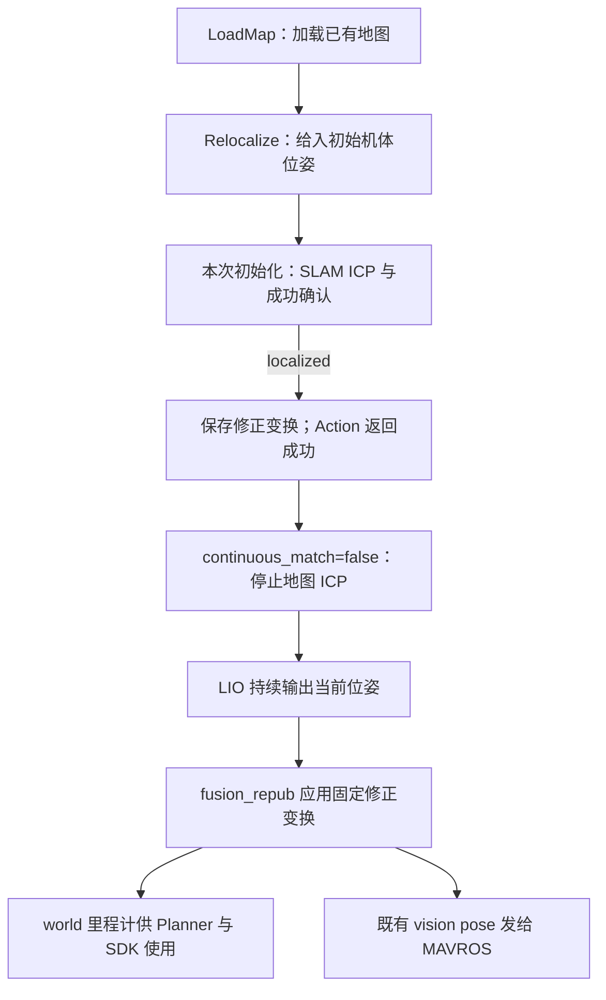

# 0.6.0：按 SLAM / WayPoint 对齐坐标接口

本版只修改 Control SDK。地图和初值遵循项目原生 `world`，Goto 位置使用 Planner 同源里程计；不修改 SLAM、WayPoint、Planner、px4ctrl 或 MAVROS，不做坐标旋转、平移或 TF 广播。

## 1. 坐标与数据来源

| 环节 | 本版约定 | 依据与处理 |
| --- | --- | --- |
| LoadMap 输入 PCD | 原生 world 中的 xyz | WayPoint 导出/加载保留点坐标；SDK 不换轴、不反转 z，只过滤非有限点 |
| 发给 SLAM 的点云 | `/drone_{id}_localization_pcl`，frame=world | `frames/world` 可配置；该配置声明坐标，不改变数值 |
| 初始机体位姿 | `/drone_{id}_initialpose`，frame=world | 与前端地图初值约定一致；空 frame 补齐，其他 frame 拒绝，四元数归一化 |
| SLAM 地图回显 | `/map`，frame=map | global_match 固定输出的标签；仍按后端协议检查，输入 world 不要求回显也改名 |
| SLAM 修正变换 | `/drone_{id}_diff_odom` | 从标定启动坐标到地图的修正，不是机体位姿；结果保留 map→world 表示法，不广播 TF |
| Goto 目标与位置 | GoalSet 原生 xyz；`/drone_{id}_visual_slam/odom` | fusion_repub 与 Planner 的 world；用该位置算距离和累计到达样本时长 |
| 起飞高度、Goto 速度 | `/mavros/local_position/odom` | 起飞为本次起点的相对 z；速度为线速度模长。SLAM 没填 twist，不能当速度零 |

配置 `topics/navigation_odometry` 留空时按 drone_id 生成；自定义 Planner 的里程计话题时，同步配置 SDK。导航里程计必须有非零时间戳、有限 xyz，frame 必须等于 `frames/world`；不符时 Goto 拒绝 error=4，执行期间距离为 NaN、不能完成，也不会回退到 MAVROS 位置。

**名称相同不证明坐标已对齐。** fusion_repub 在初始化前、匹配成功后都标记为 world：初始化前是启动坐标，成功后才是地图坐标。Goto 地图目标应在匹配成功后发送。px4ctrl 仍使用 MAVROS 本地位置；飞控是否已采用并对齐外部位姿，不能仅凭 frame 名称或 SDK 匹配成功判断。本版修正 SDK 的距离来源，没有修正飞控估计器的原点/航向。

PCD 没有本接口可验证的 frame 元数据；SDK 不读取 WayPoint 配套 JSON。输入地图及初值数值必须已处于同一原生地图坐标，修改 frame 字符串不构成坐标转换。

## 2. 起飞前只匹配一次



参考 SLAM 默认 `localization/continuous_match=false`。`success_confirm_count=10` 是**一次初始化任务内连续合格的确认次数**，不是起飞后持续进行地图匹配；SDK 不重复发初值，不自动重匹配。成功后的 LIO 位姿更新仍须继续，飞机移动时坐标才能更新。SDK 的 10 Hz 定位状态是缓存报告，不会触发 ICP。

匹配成功由后端 `localized` 决定；SDK 仍要求观察到本轮开始状态、新有效变换及有效指标。后端 JSON 会舍入 fitness，本版移除对舍入值的二次阈值比较，避免原始 0.2999999 合格、报告 0.300000 后被误判。匹配变换及状态关联限制见下方。

## 3. Orin 启动与最简监控

你的 Orin 后端编号为 2；SDK 也必须为 2。原来 LoadMap 的 error=12 来自 SDK 使用 `/drone_1_*`、后端使用 `/drone_2_*`，在发图前就被拒绝，与坐标值无关。本版错误信息会列出缺失的话题和编号。

退出旧 SDK，source 新版本工作区，再运行：

```bash
roslaunch spikive_control_sdk spikive_control_sdk.launch drone_id:=2
```

下面每条命令独立终端执行：

```bash
rostopic echo /nav/status/localization
rostopic echo /drone_2_visual_slam/odom
rostopic echo /nav/flight/goto/feedback
```

地图使用 `/home/colman/data/waypoint.pcd`，按 [定位命令](README_定位与点云加载.md#5-最简命令行案例) 先 LoadMap，再 Relocalize，等待成功后使用 [飞行命令](README_命令行测试.md)。旧客户端初值 `frame_id: map` 应更新为 `world`，或留空采用配置。Action / Service 字段布局没有改变。

## 4. 检查与验证

2026-10-16，Ubuntu 20.04 / ROS Noetic / MAVROS 1.20.1 Docker；只构建 controller_msgs、quadrotor_msgs、本包。SLAM 参考版本为 main 的 `c86c818166352ac3da7c883dad959be10b65af43`。

| 检查 | 结果 |
| --- | --- |
| 五个 Action、LoadMap、LocalizationStatus 生成 | 通过；既有字段的类型、名称和顺序未变 |
| SDK 库、C++ 节点编译链接和安装 | 通过；启用 `-Wall -Wextra -Wpedantic`，无编译警告 |
| 13 个离线 gtest | 通过；PCD/MD5/JSON、坐标数值保持、配置编号、初值及导航位姿校验 |
| 提取生产函数体的离线回归 | Goto 使用导航位置和时间戳、速度使用 MAVROS；无效导航不回退；Takeoff 断连不完成；fitness 舍入不否认后端成功 |
| 11 条请求/取消命令 | Noetic 消息填充与序列化通过；没有发送至 ROS master |
| launch / 安装依赖 | drone_id=2、world 配置展开通过；动态库无缺失 |
| 修改范围 | SDK 外 11 项目录/文件哈希不变；参考 SLAM checkout 无改动 |

离线测试可在已构建的 catkin 工作区运行：

```bash
catkin_make run_tests_spikive_control_sdk -j2 -l2
catkin_test_results build/test_results/spikive_control_sdk
```

本机日志在 `/tmp/spikive-control-sdk-coordinates-{noetic,tests,probe,checks}.log`。函数级回归使用替身输入，不验证 ROS 跨节点时序；未运行真实 ICP、Orin 实机或飞行验证。

## 5. 保留的后端协议限制

- SLAM 状态和变换没有共同请求 ID、不是原子消息。开始状态丢失可能使 Action 等待；localized 先于最终变换到达时，结果可能包含本轮较早候选变换。SDK 不伪造精确关联或匹配健康度。
- Return 的 false→true 不是目标接收确认。FlightManager 缺失或延迟时，控制器可能沿旧目标产生 returned=true；本版没有修改该协议或声称解决此问题。
- 地图与初值应在起飞前由一个入口操作；SDK 不新增飞行中切图门控。取消只结束跟踪，不停止控制或后端匹配。
