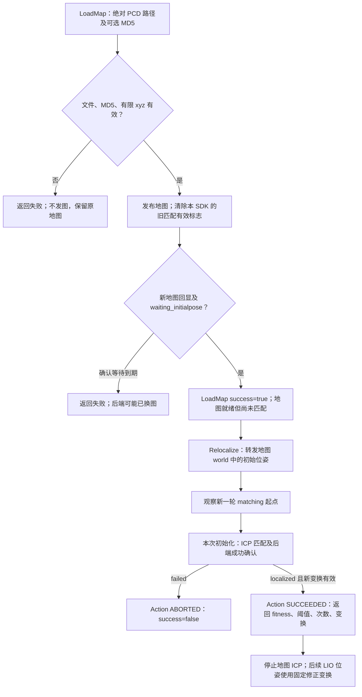

# 点云加载与初始位姿重定位

SDK 负责 PCD 校验、转发初值、监视匹配和返回结果；起飞前的一次地图匹配由原有 Spikive-SLAM 执行。成功后停止地图 ICP，飞行期间 LIO 继续输出位姿，fusion_repub 使用已确认的固定变换。SDK 不自动重触发匹配。全部新增实现位于 Control SDK，保持原来的一个节点，不修改或复制 SLAM、Planner、Manager、WayPoint 的实现。

参考 [Spikive-SLAM main 的固定版本 c86c818](https://github.com/QGDuan/Spikive-SLAM/tree/c86c818166352ac3da7c883dad959be10b65af43)，接口来自 [global_match.cpp](https://github.com/QGDuan/Spikive-SLAM/blob/c86c818166352ac3da7c883dad959be10b65af43/src/localization/global_match.cpp)、[localization.launch](https://github.com/QGDuan/Spikive-SLAM/blob/c86c818166352ac3da7c883dad959be10b65af43/launch/localization.launch) 和 [fusion_repub.cpp](https://github.com/QGDuan/Spikive-SLAM/blob/c86c818166352ac3da7c883dad959be10b65af43/src/localization/fusion_repub.cpp)。本次参考代码下载至 `/tmp/spikive-slam-reference.k7whGh`，仅供阅读，不作为编译依赖。

## 1. PDF 与 SDK 定义

| 接口 | PDF V1.1 内容 | 本次实现 |
| --- | --- | --- |
| `/nav/localization/load_map` | §3.1.4 完整定义 LoadMap.srv | [LoadMap.srv](../srv/LoadMap.srv) 保留 2 个请求、3 个响应字段的名称、类型与顺序 |
| `/nav/localization/relocalize` | 仅规定 Action 名称，没有字段 | [relocalize.action](../action/relocalize.action) 为 SDK 补充定义，发送初始位姿，返回成功、fitness、阈值、尝试次数和匹配变换 |
| `/nav/status/localization` | 仅规定 Topic 名称、10 Hz，没有字段 | [LocalizationStatus.msg](../msg/LocalizationStatus.msg) 为 SDK 补充定义，报告地图、匹配和跟踪状态 |

没有宣称后两项字段来自 PDF。初始位姿由 Relocalize Goal 给入，不额外增加一个初值 Service。未扩展 PDF 清单中的 reset、配置服务、全套状态或建图接口。

## 2. 消息对应

下表以 `drone_id=2` 为例。默认 SDK id 仍为 1，必须显式与 SLAM 对齐。

| SDK 行为 | 后端消息 / 来源 | 含义 |
| --- | --- | --- |
| 发布地图 | `/drone_2_localization_pcl` · `sensor_msgs/PointCloud2`，latched | 读取 PCD 中 float32 xyz，剔除非有限点；坐标不变，frame=`world`（`frames/world` 配置值） |
| 等待地图确认 | `/map` · `sensor_msgs/PointCloud2` + 匹配状态 `waiting_initialpose` | 后端过滤后的地图回显必须至少 5 点、frame=`map`、时间戳晚于本次发图 |
| 发布初值 | `/drone_2_initialpose` · `geometry_msgs/PoseWithCovarianceStamped` | 机体在已加载地图 world 中的初始位姿；不 latch；四元数归一化 |
| 读取匹配状态 | `/drone_2_localization_match_status` · `std_msgs/String` JSON schema 1 | 使用 `state/fitness_score/threshold/attempt_count/elapsed_ms/message`，校验 drone_id |
| 读取匹配变换 | `/drone_2_diff_odom` · `nav_msgs/Odometry` | 实际内容为 `T_map_world`，把标定启动坐标 world 转为已加载地图 map |
| 后续定位输出 | `/drone_2_visual_slam/odom`、`/drone_2_cloud_registered` | 由既有 fusion_repub 发布，header 为 world；匹配后数值对齐已加载地图。Goto 用此里程计计算距离 |

`global_match` 的 diff_odom 虽然写着 `child_frame_id=body`，其计算实际是坐标系修正变换；SDK 结果改用 `TransformStamped(map → world)`，保留采样时间。**它不是飞机的地图位置，也不作为 TF 广播发送。** 关系为 `T_map_body = T_map_world × T_world_body`。这里变换的 world 指**标定启动坐标**；fusion_repub 对齐地图后的输出也命名为 world。后端复用了名称，不能把这个修正变换再次应用到已修正的输出。`frames/world` 不改写后端变换标签。

地图和初值采用项目原生坐标、米单位，不强制 NED，不旋转、平移或重设地图原点。后端必须沿用 `localization/initial_pose_is_world=true`（main 默认值），SDK 不写该参数。Goal 的 frame 必须等于 `frames/world`（默认 world），也可留空由 SDK 补齐；其他 frame 拒绝（19），不做隐式 TF；初值 covariance 透传，但当前后端不用于 ICP 权重。

## 3. 执行流程与成功条件



**LoadMap**：接受 ASCII、binary、binary_compressed PCD，需有 float32 x/y/z 字段，剔除 NaN/Inf 后至少 5 点。额外 intensity 等字段不参与本定位适配。`map_md5` 非空时必须为 32 位十六进制 MD5，大小写均可；空值表示跳过预期值比对，仍计算实际 MD5 并报告。文件应在加载期间保持不变。

只读取现成的局部世界坐标 PCD，不把 rosbag、机体单帧点云或录制目录当作地图。参考 main 的 `save_result` 录制的是 bag，`laserMapping` 内历史 PCD 保存代码已注释；因此不能承诺启动 SLAM 后自动生成 scans.pcd。地图可使用现有 WayPoint 导出的同坐标 PCD 或已有地图结果，本次不增加地图重建/导出算法。

确认等待由 `localization/map_ack_timeout` 控制（默认 5 s，wall time），只覆盖发图后的后端确认，不是文件读取期限或飞行任务超时。等待超时返回 error=2，**不能认为后端没有换图**。实际地图库经过体素滤波后若少于 5 点，也不会通过本 SDK 的加载确认。

**Relocalize**：需先通过本 SDK 成功 LoadMap。发送初值后，先观察后端 `matching + attempt_count=0 + fitness_score<0` 的开始状态；忽略请求前缓存的 localized。成功要求后端 `localized`、fitness 有限且非负、尝试次数大于 0，以及本次初值之后采样的有效变换。变换与状态允许乱序到达；等待两者齐备后才成功。

参考后端默认在**这一次初始化任务内**做 10/5/1 三层 ICP，fitness 阈值 0.3、连续合格确认次数 `success_confirm_count=10`、匹配频率 1 Hz、匹配期限 20 s。这不是起飞后的持续地图定位。`continuous_match=false` 时，成功后停止地图 ICP；LIO 继续输出位姿，fusion_repub 继续应用已确定的修正。只在再次加载地图并给初值，或主动重新发初值时开始新任务。

SDK 读取后端 localized 判定，不复制成功计数、不把 JSON 的 `ok=true` 当作成功（idle/matching 时它也是 true）。fitness 在 JSON 中保留六位小数，原始值 0.2999999 可能报告成 0.300000，不能再按舍入值与阈值比较而否认后端成功。后端 `failed` 返回 error=17，原因字符串保留其超时等说明。SDK 不增加重定位任务超时；后端未发出开始/完成状态时持续等待，可以取消跟踪。

## 4. 结果、互斥与边界

| 字段 / 场景 | 处理 |
| --- | --- |
| `LoadMap.success` | 本轮地图得到后端回显及等待初值状态确认；不表示匹配成功 |
| `Relocalize.success` / 状态 `match_success` | 已观察到后端本轮 localized 和有效新变换 |
| `fitness_score` | 后端 ICP fitness，越小越好；-1 表示暂无数值，不是百分比或概率 |
| `match_transform` / `transform_valid` | 本轮最新有效变换及其采样时间；失败或取消时也可能有中间候选变换，不能据此认为匹配成功 |
| `tracking` | 是否有活动的 SDK 重定位 Action；取消后为 false，后端可能继续匹配 |
| 地图切换 / 后端 idle | 使当前地图和匹配标志无效；活动重定位以 error=15 中止，需重新加载 |
| 并发 | LoadMap 与 Relocalize 共享定位任务槽，忙时 error=21；Takeoff、Land、Goto、Return 四个飞行 Action 使用原飞行任务槽，未新增飞行状态门控 |
| 取消 | 仅结束 Action 跟踪，error=3；不清图、不发停止、不终止 SLAM 匹配 |

定位操作应在起飞前完成。地图更新和成功匹配会影响既有 fusion_repub 输出坐标，SDK 没有新增飞行控制或飞行中禁止切图的策略。

后端状态 JSON 没有 Header、请求 ID 或地图 MD5；地图与匹配结果也不是一个原子消息。SDK 用新地图时间戳、开始状态和新变换排除常见旧缓存，**无法证明每条消息与某个请求严格绑定，也无法将结果变换与某次 fitness 原子配对**。结果给出当前已收到的最新有效变换及其真实时间戳。使用期间须由 SDK 独占地图与初值输入，避免 WayPoint/RViz 同时切图或发初值。`/map` 是后端默认全局话题；多机部署须统一 remap 后端回显并配置 SDK，不能混用。

状态 Topic 每 0.1 s 发布一次缓存快照，`header.stamp` 是快照时间；`backend_connected` 只检查发布者存在，不保证数据新鲜。没有新增状态年龄策略或自动重试。断流不能据此声称定位健康。

## 5. 最简命令行案例

每个终端先 source 已编译的 SDK 工作区。原有 LIO、`slam_to_uav_transform` 按现有流程运行，后端需要同时间戳的 `/cloud_registered_trans` 与 `/Odometry_trans`。若尚未启动匹配节点，可单独运行：

```bash
roslaunch lsdc_slam localization.launch drone_id:=2
roslaunch spikive_control_sdk spikive_control_sdk.launch drone_id:=2
```

每条 launch 独立终端执行，已启动的节点不要重复启动。先开状态监视终端：

```bash
rostopic echo /nav/status/localization
```

加载地图，路径必须在 SDK 所在机器/容器内可读。以下使用 Orin 上的 `/home/colman/data/waypoint.pcd`；其他部署替换成实际路径：

```bash
rosservice call /nav/localization/load_map "{map_path: '/home/colman/data/waypoint.pcd', map_md5: ''}"
```

预期 `success: true, error_code: 0`；状态 `map_loaded: true, state: waiting_initialpose, match_success: false`。需要 MD5 校验时先运行 `md5sum /home/colman/data/waypoint.pcd`，将结果填入 `map_md5`。

初值发送前，在两个终端分别监视：

```bash
rostopic echo /nav/localization/relocalize/feedback
rostopic echo /nav/localization/relocalize/result
```

发送初始位姿。下面仅示例地图原点、单位四元数，请替换为飞机在该地图中的实际位置和朝向：

```bash
rostopic pub -1 /nav/localization/relocalize/goal spikive_control_sdk/relocalizeActionGoal '{goal: {initial_pose: {header: {frame_id: world}, pose: {pose: {position: {x: 0, y: 0, z: 0}, orientation: {x: 0, y: 0, z: 0, w: 1}}}}}}'
```

成功时 Action `status.status=3`，`result.success=true, error_code=0, transform_valid=true`，同时返回 fitness、threshold、attempt_count 与 `match_transform`。失败为 `status.status=4`；请求拒绝为 5。地面接口调试不需要发起飞命令。

取消跟踪：

```bash
rostopic pub -1 /nav/localization/relocalize/cancel actionlib_msgs/GoalID '{}'
```

| 诊断 | 命令 |
| --- | --- |
| 后端实际匹配进展 | `rostopic echo /drone_2_localization_match_status` |
| 后端原始匹配变换 | `rostopic echo /drone_2_diff_odom` |
| 地图回显是否在更新 | `rostopic echo -n 1 /map/header` |
| 初值确实发出 | `rostopic echo /drone_2_initialpose` |
| 后续融合位姿 | `rostopic echo /drone_2_visual_slam/odom` |

## 6. 错误码与配置

| error_code | 含义 |
| --- | --- |
| 0 | 本接口完成 |
| 2 | 发图后等待后端确认超时 |
| 3 | 重定位跟踪取消 |
| 4 | 初值位姿/协方差非有限，或四元数为零 |
| 12 | 后端话题连接或 ROS 时间不满足；LoadMap.message 列出实际缺失话题及 drone_id |
| 15 | SDK 未确认地图，或后端地图已失效 |
| 16 | MD5 不匹配、PCD 无效、字段错误或有限点不足 |
| 17 | 后端报告匹配失败 |
| 19 | 路径/MD5 格式或初值 frame 非法 |
| 21 | 已有定位任务 |
| 99 | 文件读取或其他内部异常 |

[Config YAML](../config/control_sdk.yaml) 的 `localization/*` 集中配置后端话题、服务/Action 名、状态频率和地图确认等待。四个带 drone_id 的定位后端话题留空时按编号生成；`topics/navigation_odometry` 同样按编号生成。`frames/world` 默认 world，统一地图发布、初值与 Goto 导航里程计的约定；该参数只声明/检查坐标，不执行坐标变换。SDK 不改写 SLAM 的 ICP 参数，不链接 `lsdc_slam` 库；新增编译依赖为 PCL I/O、pcl_conversions、geometry_msgs、sensor_msgs、OpenSSL 与 Boost 头文件。

普通状态、Action、反馈仍在默认单线程回调队列；只有 LoadMap 使用独立 Service 队列和互斥保护，使文件读取及确认等待不阻塞飞行回调。两个服务工作线程允许并发请求立即得到 busy，实际只允许一个定位任务执行。

## 7. 本次验证与版本迁移

0.6.0 的编译、离线测试、命令校验和已知限制统一记录于 [坐标对齐与验证](README_坐标对齐与验证.md)。未运行真实 ICP 或飞机测试。

0.5.0 的初值示例使用 map；本版按 WayPoint/前端的原生约定改为 world。客户端应更新初值 frame，或留空使用配置值。不要仅为绕过检查修改 frame；输入数值必须实际属于该地图坐标。PCD 文件本身没有本接口可校验的坐标标签；SDK 不读取 WayPoint 的配套 JSON，加载者负责提供正确地图。

Orin 此前 error=12 的直接原因是 SDK id=1、后端 id=2：请用 `drone_id:=2` 启动 SDK。修改坐标标签不能修复话题编号不一致。旧节点先退出，再启动本版；检查命令每条分别执行：

```bash
rosnode info /spikive_control_sdk_node
rosnode info /global_match
rosparam get /use_sim_time
rosparam get /localization/continuous_match
```

SDK 与后端应连接同一组 `/drone_2_*` 话题；`continuous_match` 应为 false。后端在启动时读取该参数，运行中只执行 rosparam set 不会改变已运行节点。SDK 不写入该参数。`/use_sim_time` 未设置时按 ROS 默认使用真实时间；为 true 时需要正常的 `/clock`。
