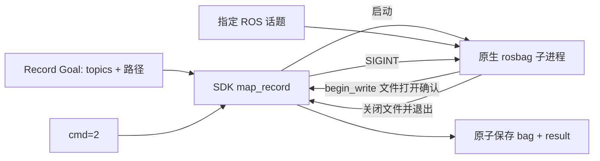

# SDK 独立录包（1.6.0）

SDK 自己运行 ROS 原生 `rosbag::Recorder`（与 `rosbag record` 同一实现），不调用 SLAM 录包后端。每次开始通过 `topics` 指定完整话题列表，原消息、坐标、时间戳保持不变。

`Record.action` 新增 `string[] topics`，消息 MD5 与 1.5 不兼容。先在 Noetic 工作区重新编译 SDK 和使用 Record 的客户端，再在每个终端重新 source：

```bash
cd ~/sdk_ws
catkin_make --only-pkg-with-deps spikive_control_sdk -j2 -l2
source devel/setup.bash
rosmsg show spikive_control_sdk/RecordGoal
```

只启动录包模块（总 launch 已启动它时不要重复启动）：

```bash
roslaunch spikive_control_sdk map_record.launch
```

## 命令行

分别开两个监控终端，再发送请求：

```bash
rostopic echo /nav/map/record/feedback
```

```bash
rostopic echo /nav/map/record/result
```

开始：修改数组即可指定自己的列表；下面只录这三个话题。

```bash
rostopic pub -1 /nav/map/record/goal spikive_control_sdk/RecordActionGoal "{goal_id: {id: 'record-start-$(date +%s%N)'}, goal: {cmd: 1, bag_path: '/home/colman/data', bag_name: 'record_test', topics: ['/nav/data/odom', '/nav/status/flight_state', '/mavros/state'], timeout: 10}}"
```

停止并保存：

```bash
rostopic pub -1 /nav/map/record/goal spikive_control_sdk/RecordActionGoal "{goal_id: {id: 'record-stop-$(date +%s%N)'}, goal: {cmd: 2, timeout: 120}}"
```

检查实际录入的话题、类型、消息数：

```bash
rosbag info /home/colman/data/record_test.bag
```

`rostopic list` 查看当前 ROS 中可选的话题；`rosbag info` 查看实际录入文件的话题。所选话题可在开始后上线；从未收到消息的话题不会出现在 bag 中。路径属于 **SDK 所在机器**，在 Orin 运行 SDK 就保存在 Orin。

## 字段与结果

| 项目 | 行为 |
| --- | --- |
| `cmd=1` | 开始；`bag_path` 为绝对目录，`bag_name` 不带路径和扩展名，`topics` 必填 |
| `topics` | 非空、无重复的绝对 ROS 话题名；不支持正则、通配符或空列表表示全录，不依赖 drone_id |
| `cmd=2` | 停止当前 SDK 会话；路径、名称和 topics 留空，使用开始时的配置 |
| `timeout` | 本次开始/停止命令的期限，秒；0 不限时，不是录包总时长 |
| 开始成功 | `feedback.state=1`；`result.success=true,error_code=0`，文件已打开，录制继续 |
| 停止成功 | `feedback.state=3`；`result.success=true,error_code=0`，最终 bag 已关闭并保存，message 给出路径 |
| 反馈 | 等待打开为 0，录制/等待停止为 1，完成为 3，失败为 4；Action 结束后不持续发布反馈 |
| 参数错误 / 重复开始 | `error_code=19` / `21`；空 topics 也返回 19 |
| 无任务可停 / ROS 时间无效 | `error_code=12` |
| 超时 / 取消 | `error_code=2` / `3`；只结束命令跟踪，仍需 cmd=2 停止；已请求的停止继续 |
| 进程或文件错误 | `error_code=99`；保留暂存文件路径，日志记录原因 |

开始成功只确认录制已打开，不代表所有话题已经收到数据；核对数据以 bag 内容为准。开始 Action 已结束后，进程异常不会追改旧 result；SDK 日志报告错误，之后的 cmd=2 返回错误原因。

## 文件与开发逻辑



只管理本 SDK 创建的子进程，不影响外部 `rosbag record`。写入目标目录内私有 `.spikive-record-*/record.bag.active`，正常停止后原子发布为 `bag_path/bag_name.bag`，拒绝覆盖同名文件。保存失败保留私有目录中的文件，不冒充成功，也不自动删除未保存数据。

SDK 正常退出时尝试停止并保存录制，最多等 5 秒；仍不能关闭则终止自己的子进程并保留暂存数据。强制断电不保证 bag 完整。bag 不等于 PCD 地图，不能直接作为 LoadMap 输入。

## 验证

Noetic/MAVROS 隔离容器内构建和测试，不连接实机。录包测试不启动 SLAM/Planner/MAVROS 后端，使用真实 Recorder 和真实 bag 验证指定话题、原消息内容、延后上线话题、重复/无效请求、超时、取消、文件冲突、子进程异常与 SDK 正常关闭。

2026-11-11 验证结果：消息生成、C++ 编译和链接通过；23 个 C++ 用例、9 个独立录包场景、16 个既有集成场景全部通过。本文两条 Record 命令通过消息填充与序列化检查，Skill 校验通过；未做 Orin 实机验证。

```bash
catkin_make run_tests_spikive_control_sdk -j2 -l2
catkin_test_results build/test_results
```
