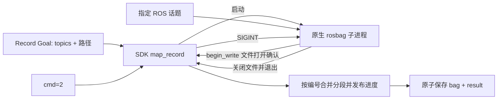

# SDK 独立录包（1.6.0）

SDK 使用 ROS 原生 `rosbag::Recorder`。在 [control_sdk.yaml](../config/control_sdk.yaml) 的 `record.topics` 配置默认话题，修改后重启录包节点。客户端可传非空 `topics` 覆盖整份清单。录制保留原消息、坐标和时间戳。

`Record.action` 新增 `string[] topics`，消息 MD5 与 1.5 不兼容。先在 Noetic 工作区重新编译 SDK 和使用 Record 的客户端，再在每个终端重新 source：

```bash
cd ~/sdk_ws
catkin_make --only-pkg-with-deps spikive_control_sdk -j2 -l2
source devel/setup.bash
rosmsg show spikive_control_sdk/RecordGoal
```

只启动录包模块（总 launch 已启动它时不要重复启动）：

```bash
roslaunch spikive_control_sdk map_record.launch
```

默认使用单包录制。将 `record.split_enabled` 设为 `true` 后启用分段，目标大小由 `record.split_size_mib` 配置，默认 500 MiB。Recorder 按原生 rosbag 的尺寸检查切换分段，实际分段大小可能略超阈值。修改后重启录包节点。

合并进度更新了 `RecordFeedback` 的消息定义。更新 SDK 时重新编译使用完整 `RecordAction` 的客户端，并让 Foxglove Bridge 从新工作区加载反馈定义。

## 命令行

分别开两个监控终端，再发送请求：

```bash
rostopic echo /nav/map/record/feedback
```

```bash
rostopic echo /nav/map/record/result
```

开始：修改数组即可指定自己的列表；下面只录这三个话题。

```bash
rostopic pub -1 /nav/map/record/goal spikive_control_sdk/RecordActionGoal "{goal_id: {id: 'record-start-$(date +%s%N)'}, goal: {cmd: 1, bag_path: '/home/colman/data', bag_name: 'record_test', topics: ['/nav/data/odom', '/nav/status/flight_state', '/mavros/state'], timeout: 10}}"
```

停止并保存：

```bash
rostopic pub -1 /nav/map/record/goal spikive_control_sdk/RecordActionGoal "{goal_id: {id: 'record-stop-$(date +%s%N)'}, goal: {cmd: 2, timeout: 0}}"
```

检查实际录入的话题、类型、消息数：

```bash
rosbag info /home/colman/data/record_test.bag
```

`rostopic list` 查看当前 ROS 中可选的话题；`rosbag info` 查看实际录入文件的话题。所选话题可在开始后上线；从未收到消息的话题不会出现在 bag 中。路径属于 **SDK 所在机器**，在 Orin 运行 SDK 就保存在 Orin。

## 字段与结果

| 项目 | 行为 |
| --- | --- |
| `cmd=1` | 开始，`bag_path` 为绝对目录，`bag_name` 不带路径和扩展名 |
| `topics` | 空列表使用 SDK 配置，非空列表覆盖配置。最终列表必须非空、无重复，且使用绝对 ROS 话题名 |
| `cmd=2` | 停止当前 SDK 会话；路径、名称和 topics 留空，使用开始时的配置 |
| `timeout` | 本次开始/停止命令的期限，秒；0 不限时，不是录包总时长 |
| 开始成功 | `feedback.state=1`；`result.success=true,error_code=0`，文件已打开，录制继续 |
| 停止成功 | `feedback.state=3`；`result.success=true,error_code=0`，最终 bag 已关闭并保存，message 给出路径 |
| 反馈 | 等待打开为 0，录制或关闭为 1，合并为 2，完成为 3，失败为 4。合并时发布 `completed_parts` 和 `total_parts` |
| 参数错误 / 重复开始 | `error_code=19` / `21`，未提供请求或配置话题时返回 19 |
| 无任务可停 / ROS 时间无效 | `error_code=12` |
| 超时 / 取消 | `error_code=2` / `3`；只结束命令跟踪，仍需 cmd=2 停止；已请求的停止继续 |
| 进程或文件错误 | `error_code=99`；保留暂存文件路径，日志记录原因 |

开始成功只确认录制已打开，不代表所有话题已经收到数据；核对数据以 bag 内容为准。开始 Action 已结束后，进程异常不会追改旧 result；SDK 日志报告错误，之后的 cmd=2 返回错误原因。

## 文件与开发逻辑



单包录制写入目标目录下的 `.spikive-record-*/record.bag.active`，停止后直接发布最终文件。启用分段时，暂存目录中的文件名为 `bag_name_序号.bag`，当前段带 `.active`。停止后按编号合并，保留 ROS 消息内容、记录时间戳和连接头。单段直接发布。多段合并需要额外容纳合并文件的磁盘空间，原子发布为 `bag_path/bag_name.bag` 后才清理分段。

合并失败或中断时，结果或日志给出保留分段的路径。用已有的 `record_bag.py merge PARTS_DIR -o OUTPUT.bag` 离线恢复，`PARTS_DIR` 填日志中的目录，输出填一个新文件名。

SDK 正常退出时尝试停止并保存录制。收尾等待超过 5 秒后会中断合并或终止未关闭的录制进程，保留暂存数据。强制断电时，最后一段可能需要重建索引。

## 验证

Noetic/MAVROS 隔离容器内构建和测试，不连接实机。录包测试不启动 SLAM/Planner/MAVROS 后端，使用真实 Recorder 和真实 bag 验证指定话题、原消息内容、延后上线话题、重复/无效请求、超时、取消、文件冲突、子进程异常与 SDK 正常关闭。

2026-11-11 验证结果：消息生成、C++ 编译和链接通过；23 个 C++ 用例、9 个独立录包场景、16 个既有集成场景全部通过。本文两条 Record 命令通过消息填充与序列化检查，Skill 校验通过；未做 Orin 实机验证。

```bash
catkin_make run_tests_spikive_control_sdk -j2 -l2
catkin_test_results build/test_results
```
