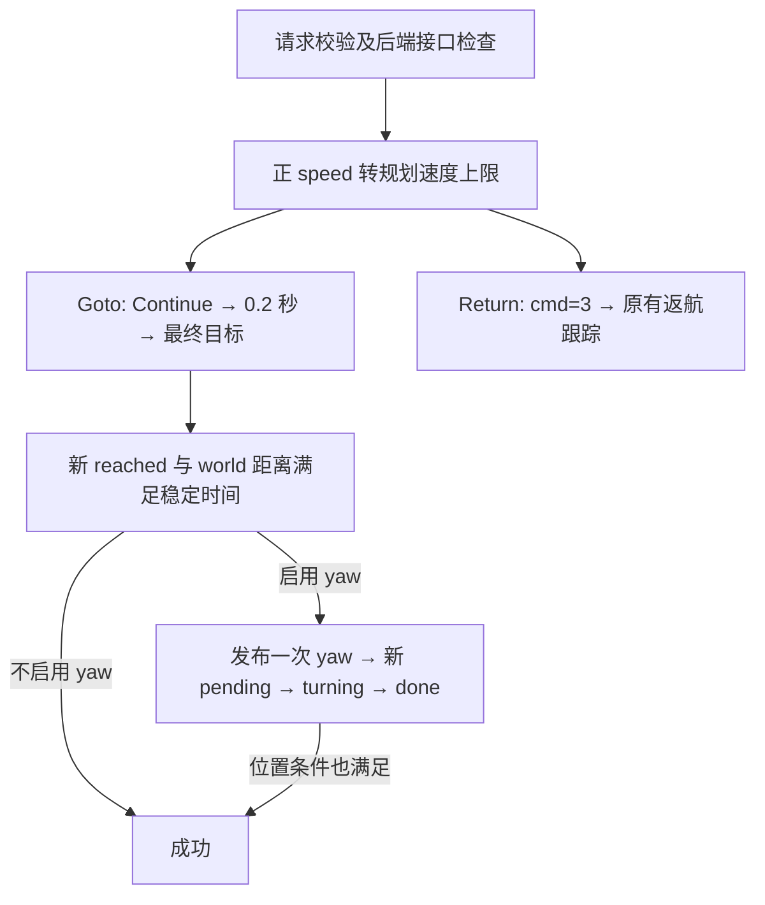

# 1.4.1：SDK → Planner 速度与终点航向

2026-11-11。只修改 Control SDK；以用户提供的 `src(1).zip` 与 `README (1).md` 的速度/yaw 接口为依据，不替换 Planner。包校验 SHA256：`28779bfbc0ea9d0c4a8e151e4a5fa7bb15160625716daeb5d1472fd99177ece4`。

## 字段映射

| SDK 请求 | 后端接口 | 行为 |
| --- | --- | --- |
| Goto / Return：speed>0 | `/drone_{id}_planning/max_vel` · Float64 | 发布一次，单位 m/s；后端持续生效的规划上限，不是瞬时固定速度 |
| speed<=0 | 不发布 | 沿用当前上限，包括之前任务设定的值 |
| Goto：yaw_enable=true | `/drone_{id}_control/yaw_override` · Float64 | 位置稳定到达后发布一次 yaw，单位 rad，原生世界轴绝对航向 |
| Goto 航向确认 | `/drone_{id}_control/yaw_override/status` · String | 新 pending→turning→done；与位置判据共同决定成功 |
| yaw_enable=false | 不发布 yaw | 沿用原有位置到达逻辑 |

消息字段、顺序、MD5 不变。Takeoff 高度输入及 Land 行为不在本次扩展范围。Return 没有 yaw 字段。

源码依据（相对新版包的 `src/planner/`）：`plan_manage/src/ego_replan_fsm.cpp` 的 `maxVelocityCallback` / `applyPendingMaxVelocity`，以及 `drone_control/src/px4ctrl.cpp` 的 `yaw_override_cb` / `update_yaw_override` / `target_cb`。话题名称由对应 launch remap。

## 执行顺序



Goto 等待航向时使用已有 state=2 HOLDING，不增加新枚举；/nav/status/flight_state 也沿用位置保持含义，不代表 yaw 已完成。Result 成功才表示本次位置和航向都完成。

后端用 MAVROS 里程计的实际 yaw 执行转向，0 朝原生 +X、π/2 朝 +Y；SDK 不换轴、不做 NED 转换。沿用既有 world 与 MAVROS 本地航向的对齐前提；SDK 不建立新坐标系。后端自行处理角度归一化、短角差、RC 自动档、OFFBOARD、解锁及稳定/速度条件。

## 完成、错误与边界

- 正 speed 在所有准入通过后、控制命令前发布；跨话题接收不具备原子顺序，也没有调速 ACK。后端可在飞行中应用新上限，不保证瞬时降速。
- 正 speed 缺订阅者，或启用 yaw 缺命令订阅者/状态发布者/已知状态，拒绝 20；非有限值拒绝 19。旧后端仍可使用 speed<=0、yaw_enable=false。
- 位置达标前不发 yaw，避免 Continue/最终目标清除尚未执行的请求。发送后只认可新状态序列，忽略缓存或直接到来的 done。
- yaw 发出后收到 idle，或观察到本机另一条有效 GoalSet（含相同坐标），以 ABORTED/error_code=3 结束；首次 pending 之后再次收到 pending，也按另一条 yaw 请求覆盖处理。
- timeout 包含规划、飞行、到点稳定和航向调整的总跟踪时间；到期 error_code=2。取消仍只结束 Action 跟踪，可能已转发的速度/yaw 不撤回，也不另外发 /control。
- 后端 yaw 状态 latched 且无时间戳/请求 ID；新序列只能排除缓存直接成功，不能证明与并发外部命令的严格归属。建议该机目标、速度、yaw 由单一业务入口管理。
- 速度不会在成功、取消或超时后恢复。需另一个速度时，在下次 Goto/Return 明确给正值；不要将 0 发给后端当停车指令。

## 配置与最简测试

[control_sdk.yaml](../config/control_sdk.yaml) 的 `topics/planning_speed`、`topics/yaw_override`、`topics/yaw_status` 留空按 drone_id 生成；部署后端须已具备这些接口。

```bash
roslaunch spikive_control_sdk spikive_control_sdk.launch drone_id:=2
```

飞机已起飞、目标确认可达后，请求速度上限 1 m/s、到点转向 +Y（替换实际 world 目标）：

```bash
rostopic pub -1 /nav/flight/goto/goal spikive_control_sdk/gotoActionGoal '{goal: {position: [1, 0, 1], speed: 1, yaw: 1.5707963, yaw_enable: true, timeout: 60}}'
```

在其他终端预先监控：

```bash
rostopic echo /nav/flight/goto/feedback
rostopic echo /nav/flight/goto/result
rostopic echo /drone_2_control/yaw_override/status
```

返航使用规划上限 0.8 m/s：

```bash
rostopic pub -1 /nav/flight/return_home/goal spikive_control_sdk/return_homeActionGoal '{goal: {speed: 0.8, timeout: 60}}'
```

只读查看新 Planner 当前接受的速度值（SDK 不写这些参数）：

```bash
rosparam get /drone_2_ego_planner_node/manager/max_vel
rosparam get /drone_2_ego_planner_node/optimization/max_vel
```

应同时记录 SDK Result、控制器状态和实际航向；位置 reached 本身不能证明 yaw 已完成。

## 验证记录（2026-11-11）

| 检查 | 结果 |
| --- | --- |
| Noetic / MAVROS 容器编译、安装 SDK 及消息依赖 | 通过 |
| SDK 原有测试与新增速度/yaw 场景 | 全部通过；catkin 汇总 66 项、0 失败（含测试包装计数） |
| 新版 Planner / px4ctrl 编译及原包回归脚本 | 通过；动态降速/提速、非法速度、一次转向、下一目标重置及取消 |
| SDK → 实际新版 px4ctrl 联调 | 通过；到点后转向成功、历史 done 隔离、RC 切换取消回报 |

新增 SDK 场景覆盖：正速度转发、拒绝请求不改速度、0 不重置；yaw 不提前发、不重复发、完整新状态序列；后端 idle/相同新目标中断；超时/取消不追加控制，晚到 done 不恢复任务。

可重复的联调脚本：[sdk_px4ctrl_yaw_test.py](../test/sdk_px4ctrl_yaw_test.py)。在同时包含 SDK 和新版 drone_control 的 ROS 环境 source 后执行：

```bash
python3 "$(rospack find spikive_control_sdk)/test/sdk_px4ctrl_yaw_test.py"
```

脚本自建本机 11341 端口的隔离 master，发布模拟 MAVROS/里程计，不启动 MAVROS。以上在无网络容器内验证；未做实机或 Orin 飞行验证。
