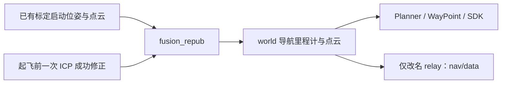

# ROS 接口规范 V1.2：第 3 章逐项核对

评审日期：2026-10-25。原文：[V1.2 PDF](specs/ROS接口规范V1.2.pdf)。基线：Control SDK `0aba861`；SLAM `main@c86c818`；Planner/WayPoint 按当前工作区源码核对，见[源码校验值](specs/V1.2_评审源码.sha256)。

**本次只评审，不修改运行代码、消息定义或原生坐标。** 原 PDF 定义保留作对照，采用方式以用户决定及表格为准。“当前是否实现”以本评审基线为准，不代表整个 V1.2 接口已提供；另一版本的成果单独注明来源。

**统一约定：所有坐标要求沿用现有 SDK/SLAM 定义；Odometry、PointCloud 沿用源消息，只可映射话题名称。** 不新增 frame 名称、换轴或重定义数据。协方差沿用用户确认的另一版本成果，本基线尚未集成，未核验该版本提交。

分类固定为以下三类；其他项目标“待归类”，只是未决标记，不是第四类。本次共 88 项：57 项可实现，18 项值得实现＋后续实现，10 项无必要实现／保持现有状态，3 项待归类。

后续可直接指定：`将 3.1.2-yaw 放入“值得实现＋后续实现”，要求……`。只更新指定行、简短要求和本页汇总；保留原定义、稳定编号与源码依据。被拆分的旧编号保留指向新编号的说明。

## 可实现

57 项：已实现 26，部分实现 1，尚未实现 30。新增确认：`3.1.4-phase-ground-detect` 复用 MAVROS 已着地信号；`3.1.5-stop` 复用既有位置保持。两项接口适配均尚未实现，其余逐项见正文。

## 值得实现＋后续实现

18 项，均尚未实现：

- Takeoff：`3.1.1-target_altitude`、`3.1.1-phase-stabilizing`。
- 速度与航向：`3.1.2-speed`、`3.1.2-yaw`、`3.1.3-speed`。
- 全部飞行 Action 请求超时：`3.1.1-timeout`、`3.1.2-timeout`、`3.1.3-timeout`、`3.1.4-timeout`。
- `3.1.1-climb_speed`、`3.1.4-descend_speed`：后续候选，**是否实施待确定，较复杂**。
- FlightState 原待定项：`3.1.6-idle-precheck`、`3.1.6-holding`、`3.1.6-navigation-return`、`3.1.6-avoiding`。
- 建图与配置：`3.3.1-map_path`、`3.3.2-process`、`3.4.1-result`。

这里的 timeout 指四个飞行 Action 的请求字段；既有地图确认等待和 SLAM 内部匹配期限保持现状。

## 无必要实现／保持现有状态

10 项：

- `3.1.2-enu`、`3.2.2-map-frame`、`3.5.1-frames`：沿用 SDK 原生坐标和 frame 名称。
- `3.1.2-state-avoiding`、`3.1.3-phase-climbing`、`3.1.3-phase-landing`：保持现有飞行阶段。
- `3.3.2-cancel-process`：不实现停止后处理。
- `3.4.1-controller-threshold`：保留启动配置，禁止飞行中修改控制器阈值。
- `3.5.1-covariance`：沿用另一版本成果，不重复开发；`3.5.1-rate`：沿用源频率，不强制 100 Hz。

剩余待归类：`3.1.3-distance_to_home`；`3.3.3-initializing`、`3.3.3-processing` 定义不明确，待定。

# 3. 详细定义

## 3.1 飞行控制

### 3.1.1 /nav/flight/takeoff — Takeoff.action

```text
# goal
float32 target_altitude       # 目标高度 m，相对起飞点地面
float32 climb_speed           # 爬升速度 m/s，<=0 使用默认
float32 timeout               # 超时 s
---
# result
bool     success
uint8    error_code
string   message
---
# feedback
uint8    phase                 # 1 PRECHECK 2 CLIMBING 3 STABILIZING 4 DONE
float32 current_altitude
float32 progress               # 0.0~1.0
```

| 编号 | 字段或能力 | 分类 | 现有来源及处理 | 当前是否实现 |
| --- | --- | --- | --- | --- |
| `3.1.1-execute` | 转发起飞命令 | 可实现 | SDK → `/control` cmd=1；原控制器执行。[F]、[C]、[P1] | 已实现 |
| `3.1.1-target_altitude` | target_altitude | 值得实现＋后续实现 | 请求值当前忽略；实际为启动时 hover_height，由 init_z 传入。后续需解决相对起飞点高度与既有控制入口的对应。[F]、[P1] | 尚未实现 |
| `3.1.1-climb_speed` | climb_speed | 值得实现＋后续实现 | 是否实施待确定，较复杂；当前忽略请求值，vz=(hover_height−position_z)×1，无逐次起飞速度入口。[P1] | 尚未实现 |
| `3.1.1-timeout` | timeout | 值得实现＋后续实现 | 当前保留但不计时；后续增加超时跟踪，终止语义待定，不据此扩展飞机控制。[F] | 尚未实现 |
| `3.1.1-result` | success / error_code / message | 可实现 | 新 tookoff=true 且 MAVROS 连接有效；拒绝/取消返回原因。成功不确认请求高度。[F] | 已实现 |
| `3.1.1-phase-existing` | phase=1/2/4 | 可实现 | 基础准入→PRECHECK；新控制器状态/MAVROS TAKEOFF→CLIMBING；tookoff→DONE。[F] | 已实现 |
| `3.1.1-phase-stabilizing` | phase=3 STABILIZING | 值得实现＋后续实现 | 后续明确稳定判据与观察时长；现有 tookoff 不能证明持续稳定悬停，无独立稳定状态。[P1] | 尚未实现 |
| `3.1.1-current_altitude` | current_altitude | 可实现 | MAVROS 当前 z−本次命令前 z，m；无效样本 NaN。仅反馈，不控制目标高度。[F]、[C] | 已实现 |
| `3.1.1-progress` | progress | 可实现 | 未完成 0，完成 1；没有连续百分比。[F] | 已实现 |

### 3.1.2 /nav/flight/goto — Goto.action

```text
# goal
float32[3] position          # ENU local world frame
float32 speed                # 巡航速度 m/s；<=0 使用默认
float32 yaw                 # yaw目标角度控制，单位rad;
bool yaw_enable               # 1 使用给定的yaw目标角度；0 无人机内部默认yaw
float32 timeout              # 超时 s
---
# result
bool     success
uint8    error_code
string   message
---
# feedback
uint8    state               # 1 NAVIGATING 2 AVOIDING 3 HOLDING 4 DONE
float32 distance_total       # 到目标三维距离 m
float32 distance_horizontal
float32 current_speed
```

| 编号 | 字段或能力 | 分类 | 现有来源及处理 | 当前是否实现 |
| --- | --- | --- | --- | --- |
| `3.1.2-position` | position：原生目标点 | 可实现 | xyz 原样转 GoalSet.goal；Continue cmd=4→0.2 s→GoalSet，不交换轴。[F]、[C]、[G] | 已实现 |
| `3.1.2-enu` | position：地理 ENU 含义 | 无必要实现／保持现有状态 | 按用户决定直接用原生 world，不要求地理东/北、不换轴；world 转发已由 3.1.2-position 实现，地理 ENU 本身不实现。[T]、[U] | 尚未实现 |
| `3.1.2-speed` | speed | 值得实现＋后续实现 | 当前忽略请求值；GoalSet 无速度字段，沿用 Planner 配置。后续需明确逐次速度入口。[F]、[G] | 尚未实现 |
| `3.1.2-yaw` | yaw / yaw_enable=true | 值得实现＋后续实现 | 后续明确目标航向入口；当前 GoalSet 无 yaw，traj_server 自算航向，PositionCommand 的输出字段不是输入接口。[G]、[P3] | 尚未实现 |
| `3.1.2-yaw-default` | yaw_enable=false：内部默认航向 | 可实现 | 保留 traj_server 的既有航向逻辑；SDK 尚无 yaw_enable 字段。[P3] | 部分实现 |
| `3.1.2-timeout` | timeout | 值得实现＋后续实现 | 当前预留；后续增加超时跟踪，终止语义待定。[F] | 尚未实现 |
| `3.1.2-result` | success / error_code / message | 可实现 | 新 reached 加同源里程计距离/稳定时长；V1.2 删掉阈值 Goal 和 final_distance，线协议需另行调整。[F] | 已实现 |
| `3.1.2-state-existing` | state=1/3/4 | 可实现 | 跟踪 NAVIGATING；reached 与距离满足后 HOLDING；样本稳定后 DONE，不另发悬停命令。[F] | 已实现 |
| `3.1.2-state-avoiding` | state=2 AVOIDING | 无必要实现／保持现有状态 | 按用户决定不增加 Goto 避障阶段；Planner 无对外完整 FSM 状态，重规划不等于正在避障。[P2] | 尚未实现 |
| `3.1.2-distance` | distance_total / distance_horizontal | 可实现 | 目标减 `/drone_{id}_visual_slam/odom`：三维范数 / XY 范数，m；无效为 NaN。[F]、[U] | 已实现 |
| `3.1.2-current_speed` | current_speed | 可实现 | MAVROS odom 线速度模长，m/s；SLAM 输出未填 twist，不能当作速度零。[F]、[U] | 已实现 |

兼容性：V1.2 新增 yaw/yaw_enable，删除到达阈值、stable_time 和 final_distance；与当前 gotoAction 字段不同，不能只改 Action 名称直接通信。

### 3.1.3 /nav/flight/return_home — ReturnHome.action

```text
# goal
float32 speed
float32 timeout
---
# result
bool success
uint8 error_code
string message
---
# feedback
uint8    phase     # 1 CLIMBING   2 ARRIVED 4 LANDING
float32 distance_to_home
```

| 编号 | 字段或能力 | 分类 | 现有来源及处理 | 当前是否实现 |
| --- | --- | --- | --- | --- |
| `3.1.3-execute` | 转发返航命令 | 可实现 | cmd=3；FlightManager 发布既有 init_x/y/z（可选 autoloc 更新 XY）。不自动采用 SDK 起飞点。[C]、[P4] | 已实现 |
| `3.1.3-speed` | speed | 值得实现＋后续实现 | 当前 Action 无此字段，后端没有逐次返航速度输入；后续需明确入口。[R]、[P4] | 尚未实现 |
| `3.1.3-timeout` | timeout | 值得实现＋后续实现 | 当前预留；后续增加超时跟踪，终止语义待定。[F] | 尚未实现 |
| `3.1.3-result` | success / error_code / message | 可实现 | 新 returned 先 false 后 true，并检查连接、未着地和新 IN_AIR；只确认现有返航状态。[F] | 已实现 |
| `3.1.3-phase-arrived` | phase=2 ARRIVED | 可实现 | 可把已确认的 returned 完成条件映射为 ARRIVED；当前 2 表示 RETURNING，4 表示 DONE。[F]、[R] | 尚未实现 |
| `3.1.3-phase-climbing` | phase=1 CLIMBING | 无必要实现／保持现有状态 | 与现有 1=PRECHECK 含义冲突，后端无独立返航爬升阶段；按用户决定不增加。[R]、[P4] | 尚未实现 |
| `3.1.3-phase-landing` | phase=4 LANDING | 无必要实现／保持现有状态 | 与现有 4=DONE 含义冲突，返航不自动降落；按用户决定不串联 Land，降落单独请求。[R]、[P4] | 尚未实现 |
| `3.1.3-distance_to_home` | distance_to_home | 待归类 | 没有唯一的返航目标确认话题；GoalSet 混有其他目标，配置 home 也可能被 autoloc 更新。[P4] | 尚未实现 |

兼容性：V1.2 增加 speed，phase 含义改动，并用 distance_to_home 替换 progress。现有 returned 不是返航目标 ACK；FlightManager 缺失/延迟时存在沿旧目标误报完成的限制。

### 3.1.4 /nav/flight/land — Land.action

```text
# goal
float32 descend_speed     # 下降速度 m/s；<=0 默认
float32 timeout
---
# result
bool success
uint8 error_code
string message
---
# feedback
uint8    phase     # 1 DESCENDING 2 GROUND_DETECT 3 TOUCHDOWN 4 DISARMED
float32 height     # 距地面高度 m
```

| 编号 | 字段或能力 | 分类 | 现有来源及处理 | 当前是否实现 |
| --- | --- | --- | --- | --- |
| `3.1.4-execute` | 转发降落命令 | 可实现 | cmd=2；下降控制由 px4ctrl 执行。[C]、[P1] | 已实现 |
| `3.1.4-descend_speed` | descend_speed | 值得实现＋后续实现 | 是否实施待确定，较复杂；当前忽略请求值，执行启动配置 landing_speed，无逐次下降速度入口。[F]、[P1] | 尚未实现 |
| `3.1.4-timeout` | timeout | 值得实现＋后续实现 | 当前预留；后续增加超时跟踪，终止语义待定。[F] | 尚未实现 |
| `3.1.4-result` | success / error_code / message | 可实现 | 新 landed 与新 MAVROS ON_GROUND 共同确认，且连接有效；不要求自动上锁。[F] | 已实现 |
| `3.1.4-phase-existing` | phase=1/3/4 | 可实现 | IN_AIR/LANDING→DESCENDING；确认着地→TOUCHDOWN；同时有新 connected 且 !armed→DISARMED。[F] | 已实现 |
| `3.1.4-phase-ground-detect` | phase=2 GROUND_DETECT | 可实现 | 按用户要求复用命令后新的 MAVROS extended_state.landed_state=ON_GROUND；当前完成检查已读取该信号，但尚未输出 phase=2。[F]、[M] | 尚未实现 |
| `3.1.4-height` | height | 可实现 | MAVROS Altitude.bottom_clearance 下方净空，有限且非负；否则 NaN。不是世界坐标 z。[C] | 已实现 |

兼容性：V1.2 删除现有 Result.disarmed；当前消息定义仍保留，不能直接与删字段后的客户端连接。

GROUND_DETECT 按“飞控确认已着地”解释；ON_GROUND 不提供提前触地或接近地面状态，LANDING 也不代表触地。它可与 TOUCHDOWN 共用着地证据，不承诺两个独立、持续可观察的阶段。

### 3.1.5 /nav/safety/emergency — EmergencyCmd.srv

```text
uint8    cmd       # 1 HOVER 悬停 2 STOP 急停 3 RESUME 恢复
---
bool success
uint8 error_code
string message
```

| 编号 | 字段或能力 | 分类 | 现有来源及处理 | 当前是否实现 |
| --- | --- | --- | --- | --- |
| `3.1.5-hover` | cmd=1 HOVER：沿用既有保持 | 可实现 | 在既有轨迹控制分支可转控制 cmd=5，保持约 0.2 s 前的位置；不承诺全模式悬停或收到执行 ACK。[P1] | 尚未实现 |
| `3.1.5-stop` | cmd=2 STOP：位置保持 | 可实现 | 按用户定义转控制 cmd=5，复用既有轨迹分支的位置保持（约 0.2 s 前位置）；沿用生效条件，不承诺全模式保持。[P1] | 尚未实现 |
| `3.1.5-resume` | cmd=3 RESUME：解除既有保持 | 可实现 | 可转控制 cmd=4；FlightManager 发当前位置，不恢复被替换的旧航线。[C]、[P4] | 尚未实现 |
| `3.1.5-result` | success / error_code / message | 可实现 | 可报告 SDK 准入和转发结果；后端无命令 ACK，不能将 success 解释成已悬停或已急停。[C]、[P1] | 尚未实现 |

HOVER/STOP 均按既有位置保持封装，不停桨；success 只表示准入及转发，不确认已经保持。RESUME 沿用 cmd=4，发送当前位置，不恢复旧航线。Emergency 服务尚未实现。

### 3.1.6 /nav/status/flight_state — FlightState.msg

```text
std_msgs/Header header
uint8    state            # IDLE(0) PRECHECK(1) TAKING_OFF(2) HOLDING(3) NAVIGATING(4) AVOIDING(5) RETURNING(6) LANDING(7) LANDED(8)
```

| 编号 | 字段或能力 | 分类 | 现有来源及处理 | 当前是否实现 |
| --- | --- | --- | --- | --- |
| `3.1.6-header` | header | 可实现 | 可封装已采用状态的时间信息；若为汇总发布时间，须注明不等于源数据新鲜度。[M] | 尚未实现 |
| `3.1.6-takeoff-landing` | state=2 TAKING_OFF / 7 LANDING | 可实现 | 可分别转换 MAVROS ExtendedState.TAKEOFF / LANDING；不与 Action phase 数值直接互拷。[M] | 尚未实现 |
| `3.1.6-landed` | state=8 LANDED | 可实现 | 可用 MAVROS ON_GROUND 配合 DroneState.landed；后者单独为真也可能在起降过渡态。[P1]、[M] | 尚未实现 |
| `3.1.6-idle-precheck` | state=0 IDLE / 1 PRECHECK | 值得实现＋后续实现 | 未运行任务不等于系统就绪；缺少完整自检状态和无数据枚举，不能把缺消息映射成 IDLE。[P2]、[F] | 尚未实现 |
| `3.1.6-holding` | state=3 HOLDING | 值得实现＋后续实现 | reached 是到达标志；当前没有全系统悬停确认。SDK HOLDING 仅表示自身 Goto 稳定观察。[P1]、[F] | 尚未实现 |
| `3.1.6-navigation-return` | state=4 NAVIGATING / 6 RETURNING | 值得实现＋后续实现 | SDK 只知道自身任务；不能据此覆盖前端/WayPoint 外部命令。全系统状态归属、优先级未定义。[F]、[P2] | 尚未实现 |
| `3.1.6-avoiding` | state=5 AVOIDING | 值得实现＋后续实现 | 内部 REPLAN_TRAJ 未发布为完整状态消息，且重规划并非必然避障；DataDisp 无对应枚举。[P2] | 尚未实现 |
| `3.1.6-rate` | 20 Hz 上报（§2） | 可实现 | 可由 SDK 定时发布状态快照；不能将重复缓存当作 20 Hz 新观测。[M] | 尚未实现 |

原枚举没有 UNKNOWN/INVALID；未知、断连、状态冲突的表示方式待明确。Planner 内部 FSM 与这里的飞行状态枚举不是一一对应关系。

用户已将本节原待定项全部列入后续实现。`3.1.6-avoiding` 是全局状态上报；`3.1.2-state-avoiding` 是 Goto 反馈，两者按各自决定处理。

## 3.2 地图加载/重定位

### 3.2.1 /nav/localization/load_map — LoadMap.srv

```text
string map_path     # PCD 绝对路径
string map_md5      # md5
---
bool success
uint8 error_code
string message
```

| 编号 | 字段或能力 | 分类 | 现有来源及处理 | 当前是否实现 |
| --- | --- | --- | --- | --- |
| `3.2.1-map_path` | map_path | 可实现 | SDK 校验本机绝对 PCD 路径和有限 xyz，按原生 world 发布定位点云。[L]、[I] | 已实现 |
| `3.2.1-map_md5` | map_md5 | 可实现 | 非空校验 32 位 MD5；空值跳过预期值比对，仍计算实际 MD5。[I] | 已实现 |
| `3.2.1-result` | success / error_code / message | 可实现 | 本次新 /map 回显与 waiting_initialpose 确认后成功；不表示匹配完成。错误列出缺失话题。[L] | 已实现 |

### 3.2.2 /nav/localization/relocalize — relocalize.action

```text
# goal
geometry_msgs/PoseWithCovarianceStamped initial_pose # 初始机体位姿位于已加载地图的原生 map 坐标系；不做 NED 转换。

---
# result
bool success
uint8 error_code
string message
float64 fitness_score         # 后端 ICP fitness，越小越好；-1 表示未获得
float64 threshold             # 后端成功阈值，不由 SDK 决定
uint32 attempt_count
bool transform_valid
geometry_msgs/TransformStamped match_transform   # T_map_world，不是机体在地图中的位姿
---
# feedback
string state                  # matching / localized / failed，沿用后端状态
float64 fitness_score
float64 threshold
uint32 attempt_count
float64 elapsed_time          # 后端 elapsed_ms / 1000
```

| 编号 | 字段或能力 | 分类 | 现有来源及处理 | 当前是否实现 |
| --- | --- | --- | --- | --- |
| `3.2.2-initial_pose` | initial_pose：原生地图初值 | 可实现 | 输入机体在地图 world 中的位姿，frame=world 或空；校验有限值、归一化四元数，covariance 透传但 ICP 不使用。[L]、[I]、[S] | 已实现 |
| `3.2.2-map-frame` | initial_pose：原文 map 标签 | 无必要实现／保持现有状态 | 不采用原文 map 标签，直接沿用现有 world；初值能力已由 3.2.2-initial_pose 实现，不改后端坐标。[L]、[U] | 尚未实现 |
| `3.2.2-result` | success / error_code / message | 可实现 | 本轮开始状态后 localized 加新有效修正变换；failed 返回失败。状态与变换无共同请求 ID，不能保证原子配对。[L] | 已实现 |
| `3.2.2-metrics` | fitness_score / threshold / attempt_count（Result、Feedback） | 可实现 | 读取 SLAM JSON 指标；fitness 越小越好，-1 未获得；不重复比较舍入后的阈值。[L]、[S] | 已实现 |
| `3.2.2-transform` | transform_valid / match_transform | 可实现 | 把 diff_odom 的修正内容封装为 T_map_world；保留采样时间，不是机体地图位姿，也不广播 TF。[L]、[S] | 已实现 |
| `3.2.2-state` | state | 可实现 | 透传后端 matching / localized / failed；不把 JSON ok=true 当匹配成功。[L] | 已实现 |
| `3.2.2-elapsed_time` | elapsed_time | 可实现 | 后端 elapsed_ms / 1000，单位 s。[I] | 已实现 |
| `3.2.2-once` | 一次初始化匹配 | 可实现 | continuous_match=false；一次任务内默认连续 10 次合格确认，成功后停止地图 ICP，LIO 继续。[S]、[U] | 已实现 |

本 Action 字段布局与现有 SDK 一致；初值采用 world。match_transform 保留 SDK 现有 map→world 表示法，其中 world 指启动坐标；它不是机体位姿，也不对已经对齐地图的导航 odom 再次应用。

## 3.3 建图

### 3.3.1 /nav/mapping/start — StartMapping.srv

```text
string map_path             # 地图保存路径
string map_name             # 地图名，不含路径/扩展名
---
bool success
uint8 error_code
string message
```

| 编号 | 字段或能力 | 分类 | 现有来源及处理 | 当前是否实现 |
| --- | --- | --- | --- | --- |
| `3.3.1-start` | 启动点云采集 | 可实现 | 可适配 WayPoint 新建 route→localization_cloud_record_start，依据带 request_id 的状态确认；不是启动 LIO 算法。[W] | 尚未实现 |
| `3.3.1-map_path` | map_path | 值得实现＋后续实现 | 后续支持请求保存路径；当前 WayPoint 项目目录、SLAM bag 目录由启动配置决定，缺少逐次路径入口。[W]、[B] | 尚未实现 |
| `3.3.1-map_name` | map_name | 可实现 | 可缓存名称，在采集停止后映射为 WayPoint save_waypoints 的 name；需完整保存流程，非 start 时已生成地图。[W] | 尚未实现 |
| `3.3.1-result` | success / error_code / message | 可实现 | 可把 WayPoint 本次 record_start 的确认/错误转换成服务结果；success 仅表示采集已开始。[W] | 尚未实现 |

本节只评估 WayPoint 的 PCD 采集流程。SLAM save_result 的 bag_record_start/stop 录制的是 bag，不能直接承诺生成同名 PCD。

### 3.3.2 /nav/mapping/set — SetMapping.srv

```text
uint32 cmd         # 1 停止map采集 2 后处理      3 停止后处理
---
bool success
uint8 error_code
string message
```

| 编号 | 字段或能力 | 分类 | 现有来源及处理 | 当前是否实现 |
| --- | --- | --- | --- | --- |
| `3.3.2-stop` | cmd=1 停止 map 采集 | 可实现 | 可转 WayPoint localization_cloud_record_stop，等待状态确认；生成临时 PCD，具名项目保存需另外完成。[W] | 尚未实现 |
| `3.3.2-process` | cmd=2 后处理 | 值得实现＋后续实现 | 后续补充任务入口及完成协议；当前参考链路未提供，PCD 降采样不等于完整后处理。[W]、[B] | 尚未实现 |
| `3.3.2-cancel-process` | cmd=3 停止后处理 | 无必要实现／保持现有状态 | 按用户决定不实现；现有链路无对应后处理取消入口。[W]、[B] | 尚未实现 |
| `3.3.2-result` | success / error_code / message | 可实现 | 停止采集可转换本次 record_stop 的状态；不支持的操作不能返回成功。[W] | 尚未实现 |

WayPoint 停止采集还会发布 localization_pcl，可能切换定位地图；这不是无副作用的录制停止。

### 3.3.3 /nav/status/mapping — MappingStatus.msg

```text
std_msgs/Header header
uint8    state   # 0 IDLE 1 INITIALIZING 2 MAPPING 3 MAPPING_FAILED 4 WAITING_FOR_PROCES 5 PROCESSING 6 PROCESSING_DONE 7 PROCESSING_FAILED
```

| 编号 | 字段或能力 | 分类 | 现有来源及处理 | 当前是否实现 |
| --- | --- | --- | --- | --- |
| `3.3.3-header` | header / 1 Hz 上报（§2） | 可实现 | 可周期封装采集状态；快照发布时间不表示采集数据新鲜。[W]、[B] | 尚未实现 |
| `3.3.3-idle-mapping` | state=0 IDLE / 2 MAPPING | 可实现 | 在“PCD 采集”范围内可映射 WayPoint idle/recording；不能解释为整个 SLAM 算法停止/运行。[W] | 尚未实现 |
| `3.3.3-failure` | state=3 MAPPING_FAILED | 可实现 | 可映射本次采集/保存实际失败；busy、非法新请求等拒绝不能覆盖正在运行任务的状态。[W] | 尚未实现 |
| `3.3.3-initializing` | state=1 INITIALIZING | 待归类 | 定义不明确，待定；现有链路没有独立建图初始化完成信号。[W]、[B] | 尚未实现 |
| `3.3.3-processing` | state=4/5/6/7 后处理阶段 | 待归类 | 定义不明确，待定；现有链路没有对应状态，recorded 或 bag 关闭不等于 PROCESSING_DONE。[W]、[B] | 尚未实现 |

## 3.4 参数配置

### 3.4.1 /nav/config/set_arrival_threshold — Set_arrival_threshold.srv

```text
float32 horizontal_distance     # 到达阈值水平距离m
float32 vertical_distance       # 到达阈值垂直距离m
---
bool success
uint8 error_code
string message
```

| 编号 | 字段或能力 | 分类 | 现有来源及处理 | 当前是否实现 |
| --- | --- | --- | --- | --- |
| `3.4.1-horizontal_distance` | horizontal_distance：SDK 到达监视 | 可实现 | 可设置 SDK 的 XY 距离比较阈值；当前只有 Goal/YAML 配置，没有本 Service。[F] | 尚未实现 |
| `3.4.1-vertical_distance` | vertical_distance：SDK 到达监视 | 可实现 | 同源导航位置可算 abs(target_z−current_z)；需新增独立垂直判据，不能直接替换现有三维半径。[F]、[U] | 尚未实现 |
| `3.4.1-controller-threshold` | 修改 Planner/控制器实际阈值 | 无必要实现／保持现有状态 | 禁止飞行中修改；reach_dist 保留既有启动配置，仅用于 XY。SDK 监视阈值不改写后端值。[P1] | 尚未实现 |
| `3.4.1-result` | success / error_code / message | 值得实现＋后续实现 | 后续返回 SDK 参数校验/应用结果，不表示控制器阈值已修改；活动任务生效规则及 stable_time 来源仍需明确。[F] | 尚未实现 |

### 3.4.2 /nav/config/set_pointcloud_config — Set_pointcloud_config.srv

```text
float32 upload_frequency        # Hz
float32 downsample_voxel        # 体素尺寸 m
---
bool success
uint8 error_code
string message
```

| 编号 | 字段或能力 | 分类 | 现有来源及处理 | 当前是否实现 |
| --- | --- | --- | --- | --- |
| `3.4.2-upload_frequency` | upload_frequency | 可实现 | 可对独立上报支路限频，保留原 stamp；不能高于源数据真实更新率来制造新观测。[U] | 尚未实现 |
| `3.4.2-downsample_voxel` | downsample_voxel | 可实现 | 可在独立上报支路做体素降采样，保留 frame；需新增 SDK 处理，不能改 Planner/定位输入。[U]、[W] | 尚未实现 |
| `3.4.2-result` | success / error_code / message | 可实现 | 可增加参数校验与应用结果；零值/负值含义及范围原文未定，实现前须明确；可复用 Config 的有限值检查方式。[CFG] | 尚未实现 |

## 3.5 数据上报

### 3.5.1 /nav/data/odom — nav_msgs/Odometry

**采用现有输出**：`/drone_{id}_visual_slam/odom` → `/nav/data/odom`，类型为 `nav_msgs/Odometry`；`header.frame_id=world`、`child_frame_id=body`。Header、pose、twist、实际发布频率沿用源消息，不拼接 MAVROS 数据。协方差沿用另一版本成果。[U]

<details>
<summary>原 PDF 字段示意（仅供核对；map/base_link 不采用）</summary>

```text
# nav_msgs/Odometry
std_msgs/Header header
  uint32 seq
  time     stamp
  string frame_id             #位姿参考系 "map"

string child_frame_id        # 速度参考坐标系，"base_link"

geometry_msgs/PoseWithCovariance pose
  geometry_msgs/Pose pose

       geometry_msgs/Point position
         float64 x, y, z
       geometry_msgs/Quaternion orientation
         float64 x, y, z, w

geometry_msgs/TwistWithCovariance twist
  geometry_msgs/Twist twist
       geometry_msgs/Vector3 linear
         float64 x, y, z
       geometry_msgs/Vector3 angular
         float64 x, y, z
```

</details>

| 编号 | 字段或能力 | 分类 | 现有来源及处理 | 当前是否实现 |
| --- | --- | --- | --- | --- |
| `3.5.1-pose` | pose.position / orientation | 可实现 | 导航 odom 可原样 relay 到 /nav/data/odom；保留已有 world/body，不改数值。[U] | 尚未实现 |
| `3.5.1-header` | header.seq / stamp | 可实现 | 无代码 relay 保留原 Header；stamp 是源里程计采样时间，不改为转发时间。[U]、[O] | 尚未实现 |
| `3.5.1-frames` | 原文 map / base_link 要求 | 无必要实现／保持现有状态 | 沿用 header.frame_id=world、child_frame_id=body；不采用原文标签，也不另起坐标系名称。[T]、[U] | 尚未实现 |
| `3.5.1-twist` | twist.linear / angular：原样上报 | 可实现 | 透传现有 twist，不补算或拼接 MAVROS；当前基线 fusion_repub 未填有效速度，默认零不作为静止判断。[U]、[O] | 尚未实现 |
| `3.5.1-covariance` | Pose/Twist 协方差 | 无必要实现／保持现有状态 | 用户确认另一版本已实现，沿用该成果，不重复开发；本基线未集成，版本提交未核验。标准 float64[36] 字段保留并随源消息透传。[U]、[O] | 尚未实现 |
| `3.5.1-rate` | 原文 100 Hz 新数据要求（§2） | 无必要实现／保持现有状态 | 改为沿用 SLAM 实际输出频率；不强制 100 Hz、不重复旧样本提频。[U] | 尚未实现 |

使用现有标准 nav_msgs/Odometry，不另造消息类型。上表“尚未实现”对应本评审基线及尚未部署的 /nav/data/odom 映射；不否定另一版本已完成协方差，也不表示仍需实现 map/base_link 或固定 100 Hz。

### 3.5.2 /nav/data/pointcloud — sensor_msgs/PointCloud2

**采用 SLAM 实际输出**：`/drone_{id}_cloud_registered` → `/nav/data/pointcloud`，类型为 `sensor_msgs/PointCloud2`，frame=world。这是当前帧配准点云；SDK 只映射话题名称，内容、时间戳和发布频率全部沿用 SLAM，不自行重定义点结构。[U]

<details>
<summary>原 PDF 字段示意（仅供核对；实际内容以 SLAM 消息为准）</summary>

```text
# sensor_msgs/PointCloud2
std_msgs/Header header
  uint32 seq
  time     stamp
  string frame_id

uint32 height                 # 点云高度（有序点云为行数；无序点云为 1）
uint32 width                  # 点云宽度（每行点数；无序点云为总点数）
PointField[] fields           # 字段描述数组（见下）
bool     is_bigendian         # 字节序（通常 false）
uint32 point_step             # 单点字节数
uint32 row_step               # 单行字节数
uint8[] data                  # 实际点数据（二进制）
bool     is_dense             # 是否含无效点（NaN/Inf）

# sensor_msgs/PointField
string name
uint32 offset
uint8    datatype
uint32 count

# datatype 取值
uint8 INT8      = 1
uint8 UINT8     = 2
uint8 INT16     = 3
uint8 UINT16    = 4
uint8 INT32     = 5
uint8 UINT32    = 6
uint8 FLOAT32 = 7
uint8 FLOAT64 = 8
```

</details>

| 编号 | 字段或能力 | 分类 | 现有来源及处理 | 当前是否实现 |
| --- | --- | --- | --- | --- |
| `3.5.2-header` | header.seq / stamp / frame_id | 可实现 | SLAM Header 原样上报，保留 world 和采样时间；仅话题改名。[U] | 尚未实现 |
| `3.5.2-layout` | height / width / fields / is_bigendian / point_step / row_step / data | 可实现 | 全部取 SLAM 消息原值，不重建点数组、不另定点数、步长或布局；客户端按实际 fields 解码。[U]、[PC] | 尚未实现 |
| `3.5.2-is_dense` | is_dense | 可实现 | 直接保留 SLAM 发布值，SDK 不重算；标准含义为 true 表示无无效点。[U]、[PC] | 尚未实现 |
| `3.5.2-pointfield` | PointField.name / offset / datatype / count；8 个类型常量 | 可实现 | 使用 SLAM 实际 fields；当前修正点云代码使用 PointXYZI，具体字段/offset/datatype/count 以输出为准，SDK 不新增字段。[U]、[PC] | 尚未实现 |

本节只做原样映射；§3.4.2 的限频/降采样是另列的可实现能力，尚未部署，不默认应用到此输出。

## 坐标与直接映射

全部接口沿用 SDK/SLAM 源码中的坐标名称和含义。输入与导航输出使用 world，导航机体系使用 body；既有地图回显 map、匹配结果 map→world 原样保留，不把所有 frame 字符串统一改成 world。

| 数据 | 原点、轴向及关系 | 实际标签 |
| --- | --- | --- |
| 标定启动位姿/点云 | 沿用 LiDAR→运动中心的既有 R/T 与 init_translation。位姿为外参共轭变换再加初始平移；点云为 Rp+t+初始平移。水平轴随原生启动/标定约定，资料不保证东/北。[T] | world / body |
| 地图 PCD、初值、Goto | 原点和水平轴沿用地图生成时的 world；默认飞行约定 z 向上。位置是绝对坐标，不是当前位置偏移；米、弧度，ROS 四元数按 x/y/z/w 表示。初值是机体在地图中的位姿。[T]、[W]、[P1] | SDK 默认 world |
| 匹配修正 | 将启动位姿对齐地图；初值修正为“地图中的初始机体位姿×启动机体位姿的逆”，随后 ICP 修正。SDK map→world 表示该修正。[S]、[L] | 后端 map/body 标签不等于真实机体位姿；SDK 既有封装为 map/world |
| 稳定导航输出 | 匹配前沿用启动坐标，成功后应用既有地图修正，点云同步修正；两阶段都叫 world。保留 body，不改为 base_link。[U] | 始终 world / body |
| MAVROS local odom | 飞控本地估计参考系；不能因收到 vision_pose 就认定原点、航向与地图一致。仅速度模长可避免向量方向混用。[P1]、[U] | 读取实际 Header，不替换标签 |

现有 traj_server 的航向按 `atan2(dy, dx)` 定义：0 沿原生 +x，正向由 +x 转向 +y；这不等于已经支持客户传入 yaw。[P3]

用户已确认全部坐标要求以现有 SDK 定义为准，原文“ENU”不作为地理东/北约束。姿态与坐标数值原样保留；不新增 NED/ENU 轴交换或重复外参变换。



以下是**未部署的无代码映射示例**，不改变源话题，也不改消息内部 frame。每条在独立终端运行，id 与后端一致；这里用 2：

```bash
rosrun topic_tools relay /drone_2_visual_slam/odom /nav/data/odom
rosrun topic_tools relay /drone_2_cloud_registered /nav/data/pointcloud
```

以上映射按当前决定保留源消息及实际频率；twist 不补算，协方差沿用另一版本成果并随源消息透传，坐标保持 world/body。命令示例未部署，不表示数据上报接口已上线。

## 依据索引

表格中的链接指向实际代码或本索引；未发布的内部变量不作为可直接订阅的接口。

- **F/C/I/L/R/G/CFG**：本仓库 [Action 节点][F]（on/updateTakeoff、Land、Goto、Return）、[命令与缓存][C]、[定位 I/O][I]、[定位闭环][L]、[现有 Return 定义][R]、[配置校验][CFG]、GoalSet 的 `int16 drone_id + float32[3] goal`（下述 Utils 消息）。
- **P1**：`Spikive-Planner-SDK/src/planner/drone_control/src/px4ctrl.cpp`：main_state、cmd_cb、extended_state_cb、publish_drone_state；启动参数见同包 `launch/px4ctrl.launch`。
- **P2**：`src/planner/plan_manage/src/ego_replan_fsm.cpp`：init、execFSMCallback、changeFSMExecState；内部枚举见同包 `include/plan_manage/ego_replan_fsm.h`；`src/planner/traj_utils/msg/DataDisp.msg` 仅 Header 和 a～e，无完整 FSM 枚举。
- **P3**：`src/planner/plan_manage/src/traj_server.cpp`：calculate_yaw、publish_cmd；**G**：`src/Utils/quadrotor_msgs/msg/GoalSet.msg`、`PositionCommand.msg`；**P4**：`src/planner/drone_control/src/flight_manager.cpp`：handleCommand、initialPoseCallback。
- **W**：`src/Spikive-WayPoint/scripts/waypoint_recorder.py`：_new_route_cb、_cloud_record_start_cb、_cloud_record_stop_cb、_save_waypoints_cb、_publish_localization_status、_publish_localization_pcl。**P1～P4/W/G 的路径相对 Planner 工作区**；不是本独立 SDK 仓库的文件。
- **T/U/S/B**：SLAM main 固定版本的 [启动标定][T]、[稳定输出][U]、[地图匹配][S]、[bag 录制][B]；对应 lioOdomCbk / pubOdom、calibratedOdomCbk / applyPendingInitialPoseIfNeeded、globalMatch / startRecordCbk、stopRecordCbk。
- **M**：[MAVROS ExtendedState][M]，State/Altitude 读取方式见 [C]。**O/PC**：[标准 Odometry][O]、[PoseWithCovariance](https://raw.githubusercontent.com/ros/common_msgs/noetic-devel/geometry_msgs/msg/PoseWithCovariance.msg)、[TwistWithCovariance](https://raw.githubusercontent.com/ros/common_msgs/noetic-devel/geometry_msgs/msg/TwistWithCovariance.msg)、[PointCloud2][PC]、[PointField](https://raw.githubusercontent.com/ros/common_msgs/noetic-devel/sensor_msgs/msg/PointField.msg)。

## 本次检查

15 个接口及原文字段逐项覆盖；按用户决定更新三类，未指定项保留“待归类”。未修改源 PDF、SDK/SLAM/Planner 运行代码或消息定义。检查章节/字段、链接、分类汇总和 Skill 格式；本轮没有重新编译或执行 ROS/飞机测试，历史编译记录不作为本版新增接口已完成的证明。

原 PDF SHA-256：`959222aa4be5b108fb09a6c9a5eb0e00b85627c411c53c8d7a2c985f58e953e7`。

[F]: ../src/flight_control_node.cpp
[C]: ../src/control_sdk.cpp
[I]: ../src/localization_io.cpp
[L]: ../src/localization_sdk.cpp
[R]: ../action/return_home.action
[G]: #依据索引
[P1]: #依据索引
[P2]: #依据索引
[P3]: #依据索引
[P4]: #依据索引
[W]: #依据索引
[T]: https://github.com/QGDuan/Spikive-SLAM/blob/c86c818166352ac3da7c883dad959be10b65af43/src/localization/flight_controller.cpp
[U]: https://github.com/QGDuan/Spikive-SLAM/blob/c86c818166352ac3da7c883dad959be10b65af43/src/localization/fusion_repub.cpp
[S]: https://github.com/QGDuan/Spikive-SLAM/blob/c86c818166352ac3da7c883dad959be10b65af43/src/localization/global_match.cpp
[B]: https://github.com/QGDuan/Spikive-SLAM/blob/c86c818166352ac3da7c883dad959be10b65af43/src/LIO/save_result.cpp
[M]: https://raw.githubusercontent.com/mavlink/mavros/1.20.1/mavros_msgs/msg/ExtendedState.msg
[O]: https://raw.githubusercontent.com/ros/common_msgs/noetic-devel/nav_msgs/msg/Odometry.msg
[PC]: https://raw.githubusercontent.com/ros/common_msgs/noetic-devel/sensor_msgs/msg/PointCloud2.msg

[CFG]: ../src/config.cpp
