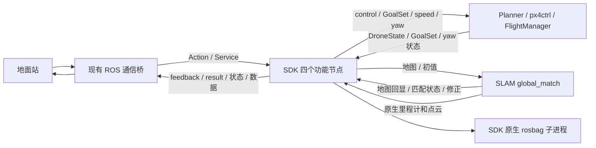

# 地面站 ↔ SDK ↔ 机载模块（v1.6）

## 接入现状与边界

这是地面站接入 SDK 的 ROS1 合同和交互要求。当前工作区可核对 Manager、WayPoint、Planner 与 SDK，没有 spikive-lichtblick 前端源码，不能声称按钮已迁移。地面站实际 WebSocket 地址、桥接协议、发布/服务调用能力及部署配置需由前端同事核对；不要把 Foxglove 与 rosbridge 的传输格式互用。下文 JSON 是 ROS 消息内容，不是未经核实的 WebSocket 数据包。

现有 Manager 的节点管理入口为 `/drone_{id}_command_topic`（astro_manager/Command），状态为 `/drone_{id}_auto_manager_status`（astro_manager/AutoManager）；源码位置是工作区 `src/Spikive-Manager/scripts/node_manager.py`。WayPoint 直接发布 `/control` 和 `/goal_with_id`，见 `src/Spikive-WayPoint/scripts/waypoint_recorder.py`。这些外部路径用于定位参考源码，不是本仓库自带模块。

地面站飞行按钮接入 SDK 后，同一次点击只走 SDK Action，避免同时走旧直接控制链路。Manager 的进程启停与 SDK 的飞行动作分开。四个飞行 Action 仅共享 SDK 内部任务槽，无法阻止 WayPoint 或其他节点发控制命令。联调时明确唯一业务控制入口。



## Action 通用收发

对每个下表 Action 基路径 B：发布 `B/goal`，类型 `spikive_control_sdk/<名称>ActionGoal`；发布 `B/cancel`，类型 `actionlib_msgs/GoalID`；订阅 `B/feedback`、`B/result`、`B/status`。前两者类型为 `<名称>ActionFeedback` / `<名称>ActionResult`，status 为 `actionlib_msgs/GoalStatusArray`。大小写必须与名称一致；Record 与 PostProcess 首字母大写。

| 按钮 | B | 名称 | 执行与成功依据 |
| --- | --- | --- | --- |
| 起飞 | /nav/flight/takeoff | takeoff | /control cmd=1；新 tookoff 状态 |
| 到点 | /nav/flight/goto | goto | Continue 后发 GoalSet；新 reached、同源距离及稳定时间；启用 yaw 时还需新航向完成序列 |
| 返航 | /nav/flight/return_home | return_home | cmd=3；返航目标由 FlightManager 管理，不自动降落 |
| 降落 | /nav/flight/land | land | cmd=2；控制器 landed 与 MAVROS ON_GROUND，阶段报告上锁信息 |
| 初值匹配 | /nav/localization/relocalize | relocalize | 已加载地图；本轮开始证据、后端 localized 与有效修正 |
| 开始/停止录包 | /nav/map/record | Record | SDK 自身录包进程打开 / 关闭并保存 |
| 点云后处理 | /nav/map/post_process | PostProcess | LIO 停止后读取已关闭 bag 的 registered cloud，拼接并保存 PCD |

地面站流程：先订阅→生成每次唯一 goal_id.id→发布一次 goal→按响应 status.goal_id.id 归属任务→feedback 更新过程→result 决定终态。不要用空 ID 连续复用任务；不要每帧重复发布 goal。

ActionGoal 包装示例（Record 开始）：

```json
{
  "header": {"seq": 0, "stamp": {"secs": 0, "nsecs": 0}, "frame_id": ""},
  "goal_id": {"stamp": {"secs": 0, "nsecs": 0}, "id": "station-session1-record-001"},
  "goal": {"cmd": 1, "bag_path": "/home/colman/data", "bag_name": "flight_001", "timeout": 10, "topics": ["/rslidar_points", "/rslidar_imu_data", "/drone_2_visual_slam/odom"]}
}
```

停止用新的 goal_id，goal 为 `{"cmd":2,"bag_path":"","bag_name":"","timeout":0,"topics":[]}`。`feedback.state=2` 时用 `completed_parts/total_parts` 显示合并进度，匹配的成功 result 确认保存并给出完整路径。连续 125 秒没有匹配的反馈或结果时，地面站显示状态未知。断线重连后同样显示状态未知。

取消当前目标：向 B/cancel 发 `{"stamp":{"secs":0,"nsecs":0},"id":"原任务ID"}`。不要把空 ID 的全取消当作单任务取消。飞行取消只结束跟踪，不制动；录包取消不等于停止，须显式 cmd=2。

Action status 与业务 result 是两层：0 PENDING、1 ACTIVE、2 PREEMPTED、3 SUCCEEDED、4 ABORTED、5 REJECTED；取消待处理还可能出现 6/7/8。按业务 success/error_code/message 展示原因，不能只看 status=3。feedback 与 result 是不同连接，可能乱序；已结束的同一目标不得被晚到 feedback 恢复成执行中。result 非持久历史，离线可能错过；前端保存自己的任务记录，重连显示不确定状态。

## 参数与状态约定

- 位置单位 m，速度 m/s，yaw 为原生 world 绝对航向 rad；不是地理北向角。导航 world/body、匹配修正 map→world 保留，不能自行换成 NED。数据改名不改变坐标。
- 起飞 target_altitude=0 沿用后端高度，非零不支持；本版本没有 climb_speed 字段。
- Goto/Return speed>0 转发持续生效的规划上限；speed<=0 沿用当前上限。完成/取消不回滚速度；非实际速度 ACK。
- Goto yaw_enable=false 忽略末端转向；true 时在到点条件满足后转发一次，等待新 pending→turning→done。前端角度输入转弧度：degree × π/180。
- timeout 对飞行及 Record 使用单调时钟，单位秒，0 禁用；Relocalize 不含 timeout 字段。Record timeout 不是录制总时长。
- UI 对未获得的距离/高度 NaN 显示“未知”，不要显示为 0；桥接端须确认非有限浮点的编码策略，不能伪造测量值。

公共失败码：2 超时、3 取消、4 位姿非法、6 未起飞、7 已在空中、12 前置条件不足、19 参数非法、20 后端能力不支持、21 忙、99 内部错误。定位还使用 15 地图未就绪、16 地图校验/PCD 错误、17 匹配失败。具体 message 原样显示，详见 [定位说明](README_定位与点云加载.md)。

## Service 和持续上报

| 接口 | 类型 | 使用方式 |
| --- | --- | --- |
| /nav/localization/load_map | spikive_control_sdk/LoadMap | 请求 map_path、map_md5；路径在 SDK 机器/容器；空 MD5 跳过预期值对比；成功后仍需另发初值 |
| /nav/safety/emergency | spikive_control_sdk/EmergencyCmd | cmd=1 HOVER、2 STOP 均位置保持，3 RESUME；success 只确认转发，不是到位 ACK |
| /nav/status/flight_state | spikive_control_sdk/FlightState | 2 Hz；缺必要状态可能停发，不将断流当 IDLE |
| /nav/status/localization | spikive_control_sdk/LocalizationStatus | 默认 10 Hz；关注 map_loaded、tracking、match_success、fitness_score、transform_valid |
| /nav/data/odom | nav_msgs/Odometry | 原生 SLAM 里程计透传，保留 Header、twist、协方差 |
| /nav/data/pointcloud | sensor_msgs/PointCloud2 | 完整源点云透传 |
| /nav/data/visual_pointcloud | sensor_msgs/PointCloud2 | 默认保留 10% 完整点记录的可视化支路，保持原 frame |

flight_state：0 IDLE、1 PRECHECK、2 TAKING_OFF、3 HOLDING、4 NAVIGATING、5 AVOIDING、6 RETURNING、7 LANDING、8 LANDED。当前无可靠 AVOIDING 证据，不生成 5。LocalizationStatus.header 为 SDK 发布时间，不证明后端采样新鲜；match_transform 是修正变换，不是机体位姿。

## 准确字段定义

以下直接取自本版 action 文件，三个区段依次为 Goal、Result、Feedback。Service 与持续状态的完整字段见 [srv](../srv) 和 [msg](../msg)。

### takeoff

```text
# V1.4; target_altitude=0 keeps the native backend height (SDK compatibility mode).
float32 target_altitude
float32 timeout
---
bool success
uint8 error_code
string message
---
uint8 phase  # 1 PRECHECK 2 CLIMBING 3 DONE
float32 current_altitude
```

### goto

```text
float32[3] position  # Native world coordinates, unchanged.
float32 speed
float32 yaw
bool yaw_enable
float32 timeout
---
bool success
uint8 error_code
string message
---
uint8 state  # 1 NAVIGATING 2 HOLDING 3 DONE
float32 distance_total
float32 distance_horizontal
float32 current_speed
```

### return_home

```text
float32 speed
float32 timeout
---
bool success
uint8 error_code
string message
---
uint8 phase  # 1 RETURNING 2 ARRIVED
float32 distance_to_home
```

### land

```text
float32 timeout
---
bool success
uint8 error_code
string message
---
uint8 phase  # 1 DESCENDING 2 TOUCHDOWN 3 DISARMED
float32 height
```

### relocalize

```text
# SDK 补充定义：PDF 仅规定 /nav/localization/relocalize 为 Action，未给出字段。
# 初始机体位姿位于已加载地图的原生 world 坐标系（frames/world）；不做坐标转换。
geometry_msgs/PoseWithCovarianceStamped initial_pose
---
bool success
uint8 error_code
string message
float64 fitness_score       # 后端 ICP fitness，越小越好；-1 表示未获得
float64 threshold           # 后端成功阈值，不由 SDK 决定
uint32 attempt_count
bool transform_valid
geometry_msgs/TransformStamped match_transform  # T_map_world，不是机体在地图中的位姿
---
string state                # matching / localized / failed，沿用后端状态
float64 fitness_score
float64 threshold
uint32 attempt_count
float64 elapsed_time        # 后端 elapsed_ms / 1000
```

### Record

```text
uint32 cmd  # 1 start recording, 2 stop and save
string bag_path  # Absolute destination directory. Empty on cmd=1 uses record/output_directory.
string bag_name  # Name without path/extension, cmd=1.
float32 timeout  # Deadline for this command, not recording duration; 0 disables.
string[] topics  # cmd=1: explicit topic override, or empty to use record/topics; cmd=2: empty.
---
bool success
uint8 error_code
string message
---
uint8 state  # 0 STARTING 1 RECORDING/CLOSING 2 MERGING 3 COMPLETED 4 FAILED
uint32 completed_parts
uint32 total_parts
```

### PostProcess

```text
uint32 cmd  # 1 start post-process, 2 stop current post-process
string map_path  # Output PCD directory; empty uses post_process/output_directory.
string map_name  # Output PCD name without path/extension; empty uses bag stem.
float32 timeout  # Deadline for this post-process command; 0 disables.
string bag_path  # Optional input bag directory; empty uses post_process/input_directory.
string bag_name  # Optional input bag name without path/extension; empty uses newest bag.
---
bool success
uint8 error_code
string message
---
uint8 state  # 0 IDLE 1 PROCESSING 3 COMPLETED 4 FAILED
```

开始成功后，`feedback.state=1` 表示正在读取 bag/拼接/写 PCD；`3` 表示最终 PCD 已保存；`4` 表示失败。成功只依据匹配 goal_id 的 result，不依据 publish 成功。LIO 节点仍在运行、bag 未关闭、无点云、输出已存在等前置条件失败不会进入 PROCESSING。`cmd=2` 只停止当前后处理，不是停止录包。详见 [点云后处理说明](README_点云后处理.md)。
