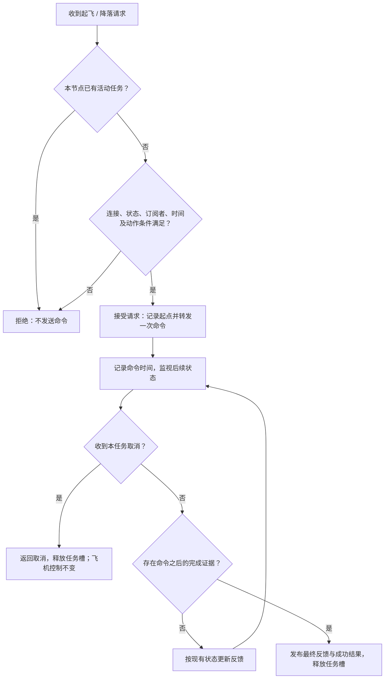
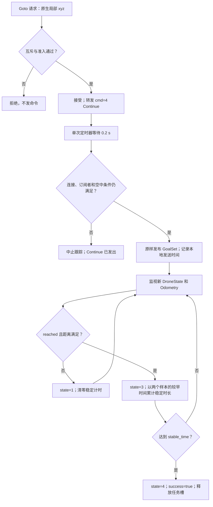

# SDK 开发逻辑：转发 → 监视 → 回传

SDK 只整理已有系统接口。发送命令代表已转发；`success` 代表观察到完成状态；`disarmed` 代表观察到已上锁。三者分别判断。

## 1. 程序只分三层

| 文件 | 做什么 | 主要入口 |
| --- | --- | --- |
| [config.cpp](../src/config.cpp) / [YAML](../config/control_sdk.yaml) | 读通信配置、到达默认值并校验 | `Config::load()` |
| [control_sdk.cpp](../src/control_sdk.cpp) | 发布命令、订阅并缓存原始状态 | `takeoff()`、`land()`、`resume()`、`goTo()`、各订阅回调 |
| [flight_control_node.cpp](../src/flight_control_node.cpp) | 检查请求、互斥、映射反馈和结果 | `onTakeoff/onLand/onGoto`、对应 update/cancel 方法 |

飞行与定位状态/Action 使用默认单线程 `ros::spin()`；新增 LoadMap 的文件读取与后端确认在独立服务队列执行，详情见 [定位开发流程](README_定位与点云加载.md)。状态回调触发完成判断；反馈 WallTimer 只定时发布反馈；另一个单次 WallTimer 在 Continue 后 0.2 s 发送 Goto 目标。`setStateCallback()` 仅接收 DroneState，`setUpdateCallback()` 接收 DroneState、State、ExtendedState、Odometry 更新通知。高度由反馈发布时读取。

直接调用 C++ `ControlSdk::takeoff()/land()/resume()/goTo()` 只转发消息；需要准入、任务互斥、取消和结果时使用 Action。保留 `ControlSdk(nh, drone_id)` 构造接口。

## 2. ROS 消息对应表

下表名称是默认配置；所有话题均可配置或 remap。

| 方向 | 话题 / 消息 | 使用字段 | SDK 用途 |
| --- | --- | --- | --- |
| 发布 | `/control` · `controller_msgs/cmd` | `header.stamp`、`cmd` | 一次发送 `1` 起飞、`2` 降落或 `4` Continue；不 latch、不重发 |
| 发布 | `/goal_with_id` · `quadrotor_msgs/GoalSet` | `drone_id`、`goal[3]` | 原生 xyz 直接转发；无 Header、速度字段或任务 ID |
| 订阅 | `/drone_{id}_state` · `controller_msgs/DroneState` | `header.stamp`、`tookoff`、`landed`、`reached` | 起降完成、阶段映射、Goto 到达依据 |
| 订阅 | `/mavros/state` · `mavros_msgs/State` | `header.stamp`、`connected`、`armed` | 连接准入、降落连接检查、独立上锁报告 |
| 订阅 | `/mavros/extended_state` · `mavros_msgs/ExtendedState` | `header.stamp`、`landed_state` | 补充控制器丢失的起降过渡态，确认真实着地 |
| 订阅 | `/mavros/local_position/odom` · `nav_msgs/Odometry` | `header.stamp`、`pose.pose.position`、`twist.twist.linear` | 起飞相对高度；Goto 到目标距离与当前速度 |
| 订阅 | `/mavros/altitude` · `mavros_msgs/Altitude` | `bottom_clearance` | 降落时报告机体下方净空 |

`DroneState` 由 `Spikive-Planner-SDK/src/planner/drone_control/src/px4ctrl.cpp` 发布至 `/drone_state`，再由 同目录的 `launch/px4ctrl.launch` 转发。它是控制器的执行状态，并非 SDK 自算的规划状态。

## 3. 请求流程

| 检查 | 条件 / 结果 |
| --- | --- |
| 公共准入 | 收到 DroneState；MAVROS 已连接；ExtendedState 为已知状态 1–4；`/control` 有订阅者；ROS 时间有效。否则 `12`。 |
| 起飞准入 | `tookoff=false && landed=true` 且 MAVROS `ON_GROUND`；空中或起降过渡态返回 `7`。里程计 z 必须有限，否则 `4`。 |
| 降落准入 | MAVROS 已为 `ON_GROUND` 时拒绝并返回 `6`；不以 `tookoff=false` 判断未起飞，不要求里程计或净空测量。 |
| Goto 准入 | 公共准入之外，要求 `/goal_with_id` 有订阅者、MAVROS `IN_AIR`、带非零时间戳的有限 xyz；否则 `12/6/4`。所有请求字段必须有限（`19`）；原生目标 z 低于 -0.1 时拒绝（`20`，后端不支持）。 |
| 互斥 / 取消 | 忙时拒绝 `21`；取消当前 Action 返回 `3`，仅释放跟踪任务。旧任务的取消不影响新任务。 |
| 完成时间 | 完成证据的 `header.stamp > command_stamp`；零时间戳和请求前缓存不能完成任务。 |

公共准入是通信和状态检查，不代表完整的飞行自检。时间戳只关联先后，不是控制器 ACK；已有协议没有任务 ID。无任务超时、状态年龄策略或自动重试，断流时缓存可能保留，不能据此声称数据仍实时。互斥只覆盖本节点三个 Action。

### Goto 流程

- `position=[x,y,z]` 原样转给 GoalSet；与 Planner、里程计共用现有局部坐标。按用户要求覆盖 PDF 的 NED 注释，不交换轴或反转 z，不添加 TF。目标是绝对局部坐标。
- 目标发送前保留 WayPoint 的 Continue → 0.2 s → 目标顺序。FlightManager 切换到 Continue 时会发送当前位置；现有协议无 ACK，这个延迟不能保证所有负载下的处理顺序。
- 距离使用目标减里程计 xyz 的三维/XY 范数；速度用里程计线速度模长。控制器 `reached` 只检查 XY，所以追加 PDF 要求的两个距离和稳定时长，缺失状态才自己计算。
- `arrival_total_dist / arrival_horiz_dist / stable_time` 正值按请求，`<=0` 使用 Config 默认 `0.30 m / 0.25 m / 1.0 s`，不改写后端参数。
- 成功要求新 `reached && !landed`、新里程计、连接与 `IN_AIR`、两个距离阈值及稳定时长。稳定计时取两个消息时间戳较小者，条件失去或时间倒退则重计；断流期间不靠反馈定时器累计时间。没有数据年龄规则，不能证明采样空隙内的状态。
- `state=3 HOLDING` 表示观察到到达条件并等待稳定，不是发送了悬停命令；缺少独立避障状态，不输出 `state=2`。结果 `final_distance` 为最新有效三维距离；位置无效或拒绝请求为 NaN。
- 取消结束跟踪，停止尚未触发的目标发送定时器；已发送的 Continue/GoalSet 不撤回，不额外发送停止或悬停。

## 4. Action 字段对应表

所有字段保持 PDF 类型与顺序；本表只解释其当前含义。

| 输出字段 | 来源 / 计算 | 条件 |
| --- | --- | --- |
| Takeoff `success` | `DroneState.tookoff` | 本次命令之后为 true 即成功；原控制器条件为 `takeoff_triggered && is_in_air && abs(hover_height-position_z)<0.1` |
| Takeoff `phase` | 既有状态映射 | 接受时 `1 PRECHECK`；新控制器状态 `landed=false`，或新 MAVROS 状态 `TAKEOFF/IN_AIR` 时为 `2 CLIMBING`；成功 `4 DONE`。完成与阶段更新均需新 DroneState；其余保持 PRECHECK。无独立稳定状态，不输出 `3`。 |
| Takeoff `current_altitude` | MAVROS `z - 本次命令前的 z` | 只作反馈；收到无效 z 时输出 `NaN` |
| Takeoff `progress` | 完成状态 | 未完成 `0`，完成 `1` |
| Land `success` | `DroneState.landed && ExtendedState.ON_GROUND` | 两个状态均在命令之后，且 MAVROS 当前连接有效 |
| Land `phase` | 既有状态映射 | 接受后及 `IN_AIR/LANDING` 为 `1 DESCENDING`；成功时 `3 TOUCHDOWN`，同时确认上锁则 `4 DISARMED`。没有独立触地检测信号，不输出 `2`。 |
| Land `height` | MAVROS `Altitude.bottom_clearance` | 有限且非负时直接反馈；未收到或无效时 `NaN`；不参与成功判定 |
| Land `disarmed` | MAVROS `State` | 新的 `connected=true && armed=false` 才为 true；false 表示未确认。拒绝请求时按已有非零时间戳的状态报告。 |
| 三个 `error_code / message` | 适配结果 | `0` 成功；`3/4/6/7/12/19/20/21` 见请求表；message 解释原因 |

Land 的初始 DESCENDING 表示开始跟踪降落，并不是速度测量确认。降落在确认着地时返回成功，`disarmed` 是该时刻的快照，不等待后续上锁。取消返回 `success=false`，不改变飞行状态。

Takeoff/Land 输入的 `target_altitude/climb_speed/descend_speed/timeout` 全部预留，任何值均忽略并写请求日志。Goto 的 `speed/timeout` 也预留，但仍检查有限值。实际高度和速度仍由 px4ctrl 决定，详见 [README 对应表](../README.md)。

## 5. 逻辑核对结论

| 核对项 | 处理 |
| --- | --- |
| 控制器把 `TAKEOFF/LANDING/UNDEFINED` 也归为 `landed=true` | 起飞准入补查 MAVROS `ON_GROUND`；降落成功必须双状态确认；MAVROS `TAKEOFF` 可补充起飞阶段。 |
| `LANDING` 仅表示正在降落 | 映射为 DESCENDING，不伪造 GROUND_DETECT。 |
| 无效里程计曾保留旧高度反馈 | 改为 `NaN`；断流保留缓存仍属未实现的状态年龄策略。 |
| 已发送命令与实际执行 | SDK 不输出 setpoint、不调用 MAVROS 控制服务；只有状态证据能完成任务。 |
| `disarm()` 只有定义没有调用 | SDK 只读 `armed`，不承诺自动上锁。 |
| Planner 地面高度与 MAVROS 高度 | `/ground_height_measurement` 是轨迹前方地面坐标 z，不是当前下方净空；不用于 Land.height。 |
| 原控制器的降落门控 | LANDING 会令 `is_in_air=false`，而下降分支要求 `landing_triggered && is_in_air`。该后端限制保留，SDK 只监视，不接管或修正飞行控制。 |
| Goto 与 Planner 的协议依赖 | 依赖 `/control` 的 cmd=4、GoalSet 和 DroneState 的既有语义；不是零耦合。SDK 不链接 Planner/px4ctrl 的实现，不调用 MAVROS 控制 Service 或写飞控参数。 |
| Goto 后端限制 | Planner 忽略 z<-0.1；地形跟随可能改写 z；px4ctrl 只在 XY 改变时更新到达过程。SDK 按原请求监视距离，可能持续等待，不代修后端。 |
| Config / 构建 | 默认值 → 私有参数；launch 先加载 YAML 再设置 id。校验 id 在 0–32767、频率与到达默认值有限正值、名称非空、三个 Action 名不同；安装库、头文件、节点、Action、launch、config、文档。 |

验收只做 PDF 字段核对和 Noetic 编译链接，不执行飞行测试。后续扩展保持“现有状态优先，缺失信息才补 MAVROS；描述 + 对应表 + 流程图”的结构，不增加独立控制逻辑。

## 6. 地图与定位适配

| 文件 | 职责 |
| --- | --- |
| `localization_io.cpp` | 校验并读取 PCD/MD5，解析 SLAM JSON 状态；不运行配准算法 |
| `localization_sdk.cpp` | LoadMap Service、Relocalize Action、10 Hz 定位状态、后端回显确认及结果转换 |
| `LoadMap.srv` | PDF V1.1 原定义 |
| `relocalize.action` / `LocalizationStatus.msg` | SDK 补充协议，字段和成功条件见定位 README |

定位只通过已有 ROS 话题与 SLAM 交互，不写 SLAM 参数，不修改匹配算法或 MAVROS 输出。LoadMap 与 Relocalize 共用定位任务槽，与三个飞行 Action 的任务槽分开；Service 回调线程共享状态用互斥保护。全流程、消息对照和命令见 [定位与点云加载](README_定位与点云加载.md)。
