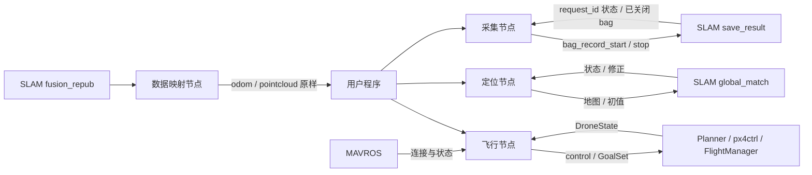

# V1.4 开发逻辑：按后端职责拆节点

所有实现位于 Control SDK，后端仍按既有系统启动。共用配置文件，各节点读自己的私有参数；发布者/订阅者存在只用于通信准入，不当作执行 ACK。

| 节点 / 代码 | 对应模块 | 负责内容 |
| --- | --- | --- |
| [flight_control_node.cpp](../src/flight_control_node.cpp) + [control_sdk.cpp](../src/control_sdk.cpp) | Planner / FlightManager / px4ctrl | 四个飞行 Action、Emergency、2 Hz FlightState；共用飞行任务槽，状态来自控制器与 MAVROS |
| [localization_node.cpp](../src/localization_node.cpp) + [localization_sdk.cpp](../src/localization_sdk.cpp) | SLAM global_match | LoadMap / Relocalize / 定位状态；保留独立 LoadMap 队列与互斥锁 |
| [map_record_node.cpp](../src/map_record_node.cpp) + [record_io.cpp](../src/record_io.cpp) | SLAM save_result | 启停 JSON、request_id 确认、目标文件整理；文件线程不阻塞 ROS 回调 |
| [data_mapping_node.cpp](../src/data_mapping_node.cpp) | SLAM fusion_repub | 仅映射话题，完整保留 Odometry、PointCloud2，禁用 roscpp 自动改写 seq |
| [config.cpp](../src/config.cpp) / [YAML](../config/control_sdk.yaml) | SDK 配置 | 通信命名、原生 frame、SDK 到达判据；不写后端参数 |
| [action_support.h](../include/spikive_control_sdk/action_support.h) | 公共工具 | 结果码、单调时钟任务期限 |

## 飞行跟踪

接受 → 转发一次命令 → 读取新状态 → 完成/失败。Takeoff 使用 tookoff；Land 使用 landed + ON_GROUND；Goto 使用 reached + 同源 world 位置的距离/稳定观察；Return 使用命令后的新 GoalSet 及 returned false→true。具体阶段和边界见 [V1.4 说明](README_V1.4_实现与验证.md)。

Goto 按 WayPoint 的 Continue→0.2 s→目标顺序，期间允许取消和超时。任务到期/取消不会自动发停止、悬停或降落；Emergency 是明确的控制请求。观察更新的外部控制命令时结束不再对应的 SDK 任务。Return 目标没有任务 ID，距离和完成仍受后端协议关联限制。

## 定位与坐标

原生 world 初值、地图、目标保持一致；导航里程计沿用 world/body，匹配结果沿用 map→world。定位节点不广播 TF、不重复修正导航位置。一次初始化匹配内部可多轮确认，成功后不再次发初值；LIO 位姿流仍继续。

## 采集与并发

每个节点独立进程，飞行/数据映射使用单线程回调。定位节点保留 LoadMap 专用队列与锁。采集节点的协议状态只在 ROS 回调线程访问，文件导出线程只接收路径副本和原子取消标志；Timer 取回结果后更新 Action。取消/超时后仍读取晚到回报，但不恢复旧 Goal。

新地图回显改变会使既有定位状态失效。采集只操作 save_result 的 bag 协议，不调用 WayPoint 的 PCD 停止采集逻辑，避免顺带切换定位地图。后处理和三阶段配置仍按后续需求安排。
